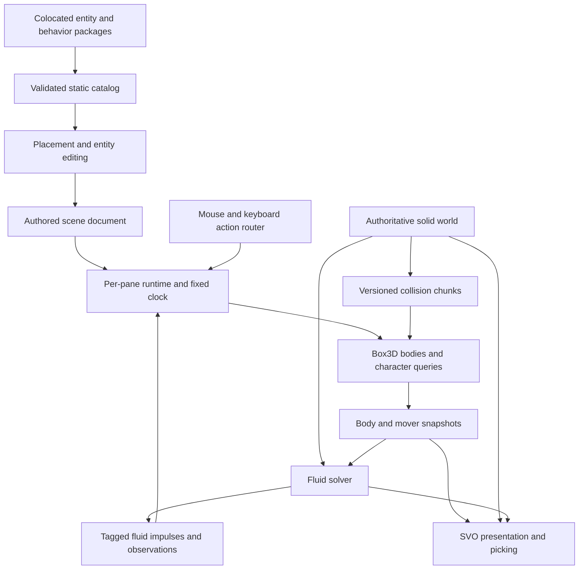

# Interactive scene architecture and experience proposal

## Implementation scope and UI handoff

The implementation scope now includes the production headless runtime and application adapters. The UI handoff has been sent; placement surfaces, inspectors, DOM event wiring, camera presentation and styling remain with that developer.

Implemented entry points:

- `lib/interaction/index.ts`: catalog, contracts, production declarations, host and input router.
- `lib/interaction/features/`: colocated character, crate, switch, platform and trigger definitions and runtime factories.
- `lib/interaction/adapters/box3d/`: pinned `box3d-wasm@0.2.0`, native worlds, shapes, motors, constraints, sensors and snapshots.
- `lib/interaction/adapters/solid-world/`: fixed-resolution collision chunks and overlap preflight.
- `simulation.interaction(paneId)`: scene/history lifecycle and one native world per pane.
- Render-worker RPC and the uniform fluid adapter: serialized pressure-traction feedback, with GPU rigid integration disabled for interactive scenes.
- Interactive playground and pool presets: actual authored scenes, with no hard-coded entity dispatch in UI components.

The binding spike changed two implementation choices. The pinned Wasm binding does not expose the experimental geometric mover or triangle-mesh construction. The initial character therefore uses an upright dynamic capsule with locked rotation, bounded motor impulses, jump buffering/coyote time, slope-aware support rays and step clearance. Continuous static boundaries are represented by clipped tetrahedron convex hulls, and whole cells by merged boxes. Cavities remain empty; collision detail is independent of camera/SVO detail. These are explicit approximations, not claims of exact analytic surface collision.

The current render/fluid ABI supports 12 physical bodies; capacity is rejected explicitly. Sensors do not occupy render/fluid slots. Collision coverage is bounded to 32,768 chunks and overlap sampling to two million points per validation. Large worlds and more bodies require a coordinated capacity change. Collision chunks retain unchanged native shapes, although discovering changes currently scans source coverage; a dirty-region index is a later performance improvement.

Dry play is operational. Wet play uses the existing uniform solver's pressure-traction path and a serialized compact readback. The receiving UI developer can start integration through the [updated handoff](interactive-scenes-ui-handoff-2026-10-18.md). Numerical and performance evidence is recorded with the implementation verification below; the broader research fixtures in the original delivery sequence remain useful follow-up coverage.

Add placeable characters, props, mechanisms and triggers through colocated feature packages. Each package owns its document schema, editor presentation, runtime behaviors and tests. The host owns input routing, lifecycle, scheduling and publication. Box3D supplies rigid physics and collision queries; the existing solid world, fluid methods and SVO presentation remain distinct systems connected by explicit contracts.

The first playable scene should let someone place a character, control it around edited solids, push a box, activate a switch and enter shallow water. Deliver this in stages so dry interaction establishes the architecture before fluid feedback introduces a CPU/GPU dependency.



## Existing foundations and required changes

| Existing code | Reuse and change |
| --- | --- |
| `lib/framework/composition.ts` and `ports.ts` | Reuse validated static composition, capability requirements and publication representations. Runtime scheduling needs an additional explicit phase contract. |
| `lib/core/editor-entity.ts` and `editor-entity-catalog.ts` | Reuse entity-owned picking, handles, fields and actions. Add one generic interactive-entity adapter whose providers come from feature packages. |
| `lib/core/voxel-editor/plugin.ts` | Follow its colocated metadata and gesture model. Entity placement deserves its own contract; voxel patches and numeric-only tool values do not describe entity instances. |
| `lib/features/rigid-placement/` | Extend the existing ring and toolstrip placement experience through a shared entity catalog. |
| `lib/core/session/session.ts` | Give each pane an independent interactive world, input state and physics world. |
| `lib/core/simulation/controller.ts` and `simulation/pane-clock.ts` | Retain transport and the shared clock. Delegate interactive execution to a runtime host instead of growing entity-specific controller methods. |
| `lib/core/model.ts`, scene stores and scene persistence | Add versioned entity records, migrations and reference validation; preserve authored state separately from simulation state. |
| `lib/core/scene-runtime.ts` and resource readiness | Derive required interaction, collision and physics capabilities from entity composition, including dry scenes. |
| `lib/core/webgpu-rigid-body.ts` and `lib/methods/uniform/webgpu-uniform-reference.ts` | Extract body publication and fluid exchange from rigid integration. A Box3D-controlled body must never also run the existing GPU integrator. |
| `lib/svo/contracts/scene-publication.ts` and the SVO rigid raster path | Publish transforms, bounds, owner mapping and revisions from the same runtime snapshot used by picking. |

Current constraints are architectural work items: `RigidBodyDescription` only declares static/dynamic motion, GPU rigid capacity is 12 with shader loops and arrays depending on it, and scenery owner IDs begin after that reserved range. One open-world terrain configuration rejects rigid bodies. These limits need explicit capability checks during rollout and targeted changes before advertising broader support.

## Colocated packages and composition

Use a small entity/behavior model with ordinary TypeScript modules. An entity kind is a placeable recipe; behaviors are reusable capabilities attached to an instance. A character recipe composes a capsule representation, character motor, player control, follow camera and optional water response. A floating crate composes a rigid body, grab interaction and fluid participation. A switch composes an interaction target and a typed activation output.

Suggested layout:

```text
lib/interaction/
  contracts/                 # records, actions, commands, snapshots, ports
  catalog.ts                 # explicit static imports and composition
  runtime/                   # lifecycle, phases, events, input arbitration
  adapters/
    box3d/                   # Wasm loading, handles, queries, stepping
    solid-world/             # collision chunks and revision publication
    fluid/                   # boundary upload and impulse exchange
    svo/                     # representation, picking and owner mapping
  features/
    character/
      definition.ts          # recipe and capability declarations
      schema.ts              # configuration, validation and migration
      editor.ts              # placement, handles, fields, actions
      motor.ts               # reusable character movement behavior
      player-control.ts      # actions to movement intent
      presentation.ts        # capsule visual initially; avatar later
      tests/
    rigid-prop/
    switch/
    moving-platform/
    trigger-volume/
```

Each package exports declarations for entity kinds and any behaviors it owns. The catalog composes those declarations once, adapting them into existing editor and framework slots. Adding a kind requires its package and one catalog entry; viewport, keyboard, physics and persistence code must not switch on its kind ID. Shared behavior implementations have one owner and can be referenced by other recipes without copying them.

Implemented declaration split, abbreviated here; the exported types in
`lib/interaction/contracts/index.ts` are authoritative:

```ts
interface EntityKindPlugin {
  id: string;
  schema: ConfigSchema; // version, defaults, validate, migrate
  editor: EditorMetadata;
  placement: PlacementPolicy;
  preview(config: JsonObject): PreviewPrimitive;
  compose(config: JsonObject): readonly BehaviorRecord[];
}

interface BehaviorPlugin {
  id: string;
  schema: ConfigSchema;
  editor: EditorMetadata;
  requires?: readonly string[];
  provides?: readonly string[];
  requiresHost?: readonly string[];
  actions?: readonly ActionDefinition[];
  phases: readonly BehaviorPhase[];
}

interface BehaviorRuntimeFactory {
  type: string;
  create(entity: EntityRecord, behavior: BehaviorRecord): BehaviorRuntime;
}
```

`PlacementPolicy` above abbreviates the inline placement type. Phase declarations identify execution phases and capability dependencies; `provides` declares exclusive entity-local ownership. The catalog validates missing dependencies, cycles, duplicate IDs, incompatible representations and competing transform/motor owners before a host allocates a world. Stable IDs resolve ties in execution order. Runtime factories are a separate adapter contract. A behavior submits typed commands through its tick context; it does not install DOM handlers, access React stores, or call a fluid method directly.

Begin with explicit phases and a small command vocabulary. Add a general scheduler or data-oriented entity storage only when measurements or real compositions demand it. Plugins are bundled trusted code; scene JSON contains configuration, never executable scripts or import URLs.

## Document and runtime state

Introduce optional `entities` and typed `connections` in a migrated scene schema. A record contains a stable ID, namespaced kind, kind version, name, authored transform, kind configuration, and versioned behavior instances with stable IDs. Recipes expand default behaviors; persisted overrides refer to behavior instance IDs. A connection names source entity/behavior/output and target entity/behavior/input. Validate compatibility and dangling references before starting play.

For example, a switch's `activated` event can invoke a platform's `toggle` action. Events generated in a tick are delivered in a defined later phase or the next tick; graph cycles cannot recurse without bound. Duplicate remaps internal references together, preserves explicit external references, and undo restores the same IDs.

Document state includes spawn poses, settings and connections. Runtime state includes current poses, velocities, grounded state, trigger occupancy, pending commands, control ownership and physics handles. Selection and camera preference are pane UI state. Save/autosave serializes the document; simulation never appends pose history to it. Reset reconstructs runtime from the document. A later explicit “Keep current poses” operation can make one undoable document edit.

Initially adapt existing `rigidBodies` into runtime entity instances with reserved IDs while keeping their current serialization. New interactive entities own their bodies through their recipes; do not serialize a second copy into `rigidBodies`. Both sources compile into one physics roster. Old files load with no entities, while export/import and library validation understand the new schema. Preserve unknown plugin records losslessly, show an unavailable placeholder, and block affected simulation rather than silently deleting them.

Structural authoring edits during play require pausing and a clear apply boundary. Cheap parameter changes may declare `live`; collider changes declare `rebuild`; initial-condition changes declare `reset`, following existing update-impact vocabulary. Temporary runtime spawning can come later as a distinct command with no implicit document mutation.

## Placement and authoring experience

Add an **Interactive** group to the scene ring and the existing placement surface. Both enumerate the same plugin metadata: Characters, Props, Mechanisms and Triggers, with search when the catalog outgrows a compact menu. Start with Character, Crate, Switch and Platform. The kind provides defaults, icon, placement policy, editable fields and availability reasons.

Placement follows the existing preview/commit pattern:

1. Choose an element; a ghost follows the scene ray, using the accepted collision generation and surface normal.
2. Show its footprint, facing and clearance. Characters remain upright and stand with feet on the surface; slope alignment is a policy for other kinds. A ground-plane fallback is visibly marked when there is no surface hit.
3. Offer snap and orientation controls with an on-screen hint. Invalid overlaps stay visibly invalid with a concrete reason. Triggers may overlap by design.
4. Click to commit one undoable instance; Escape cancels. Continue placing only when repeat placement is explicitly enabled.
5. Select the instance to expose normal transform handles and compact plugin-owned fields. Its Behavior section lists attached behaviors and compatible additions. Target fields support picking an entity directly in the viewport.

A character shows speed, jump height and camera distance first. Advanced motor and fluid settings stay folded. The **Control** action is prominent when the runtime is ready; pressing it from paused state starts simulation and acquires input in one gesture. A scene may declare a preferred player character, but ordinary Play does not unexpectedly capture the pointer.

## Simulation interaction and input ownership

Keep simulation transport and interaction context separate. The clock can run while someone observes, plays or uses an allowed live tool. Preserve the existing LOOK/EDIT modes and introduce a distinct Play context; the existing internal `interact` mode already means editor interaction and should not be overloaded.

| Context | Mouse | Keyboard |
| --- | --- | --- |
| Edit | Select, place, transform and sculpt through existing gestures | Existing authoring shortcuts |
| Observe while running | Existing camera navigation; hover/click exposes available runtime actions | Transport and observer commands |
| Control character | Third-person follow camera; drag to orbit by default; optional explicit pointer lock for continuous look | WASD move, Space jump, Shift run, E use, Escape release control |
| Runtime grab | Drag drives a limited force/constraint target; release drops | Cancel releases the constraint; plugin hints show other supported actions |

Use physical key codes for movement with configurable bindings and readable labels. First-person camera, gamepad and alternate character types can reuse the same logical actions later. Provide a visible Control/Release button and mouse-accessible runtime action menu so discoverability does not depend on memorizing keys. Pointer-lock failure falls back to drag-to-look.

One input router arbitrates in this order: text/modal UI, active pointer gesture, possessed entity, observer/editor context. Route each event once. Escape closes the innermost modal or gesture, otherwise releases possession and pointer lock while simulation continues; the transport retains an explicit Pause control. Pausing suspends gameplay actions and releases pointer lock; resuming requires a fresh gesture to lock again. Never let Space both jump and toggle transport, or E both activate and invoke an editor shortcut.

On blur, hidden tab, pointer-lock loss or pane switch, clear held buttons and pointer deltas. Losing pointer lock releases control. Only the focused pane owns gameplay input; A/B input mirroring must be an explicit comparison option. Queue pressed/released edges with sequence numbers for the next admitted fixed tick, sample held values once per tick, and consume edges once even when several ticks run in a render frame. Camera motion can update at render frequency; movement uses simulation time.

Runtime targeting combines the current view ray, interaction range and occlusion query. Entity behaviors declare actions and priority; the host displays a concise prompt such as “E · Open gate”. Revalidate the target on the execution tick. Contact and sensor events carry entity IDs and generations, with deletion invalidating pending references.

## Box3D integration and character movement

Use [Erin Catto's Box3D](https://github.com/erincatto/box3d), as confirmed for this project. Its upstream documentation lists collision queries, sensors, joints and WebAssembly build instructions. Pin an upstream revision and isolate its API behind our adapter. The [community Wasm binding](https://github.com/monteslu/box3d-wasm) is pinned at 0.2.0 in the package lock; its unsupported APIs are isolated by the adapter.

Start with a dedicated Box3D Wasm module hosted alongside the simulation controller, using batched uploads and reads. A worker can replace this execution host if profiling justifies it. Do not tie rigid backend selection to `PhysicsExecutionBackend`, which currently selects where fluid physics runs. Reuse readiness and disposal conventions from the existing Wasm infrastructure without assuming its Rust ABI can load the C library unchanged. Test the single-threaded path first and gate threaded loading on actual browser support.

Define services for body creation/removal, shape queries, kinematic targets, impulses, joints, sensors and snapshots. Keep metre/second/kilogram units and explicit quaternion conversion. Runtime entity IDs map to generation-checked engine handles; copy transient engine events before stepping again. Each pane owns and destroys its own world, with cleanup on reset, scene replacement and failure.

Box3D owns dynamic body transforms, including the initial character. Kinematic mechanisms provide commanded trajectories. Upstream's [experimental character mover](https://github.com/erincatto/box3d/blob/main/docs/character.md) is not exposed by the pinned binding, so it is not used by this implementation.

The character motor applies bounded acceleration and braking impulses to an upright rotation-locked capsule. Support queries enforce slope eligibility, coyote time and buffered jump edges. Step-up uses lower/upper clearance rays and a landing query. Native contacts handle pushing props and vertical platform carry; support velocity also contributes to horizontal motion. Camera clearance is exposed as a conservative ray fan for the UI's third-person camera. These clearance tests are fixed-resolution approximations; they do not promise exact capsule sweeps at corners.

The same capsule supplies the fluid boundary. Pressure impulses are applied once to its native body; submerged fraction reduces movement speed and enables swimming jump intent. No additional buoyancy force is layered onto pressure traction. Motors and kinematic platforms are externally powered; their work must be separated from closed-system momentum accounting.

## Solid world and SVO integration

The authored solid world is the geometry source. SVO render resolution, camera-dependent meshing, cutaway walls and lighting caches must not determine physical collision.

Build collision chunks from the accepted solid revision. Use merged voxel boxes for blocky regions and clipped cell tetrahedra from the authoritative continuous boundary for procedural regions. Preserve validity masks and voxel-edit overrides from the procedural-solid path. Height fields apply only where the source really is a single height surface. Caves, cups and overhangs require geometry that preserves their empty spaces; a convex hull around a cup would seal it.

Cache collision products by source revision, chunk and representation parameters. Rebuild only dirty chunks plus boundary neighbors; retain the old generation until a replacement can be committed atomically. At a fixed-tick boundary, activate matching fluid and collision geometry. If either is unready, pause affected simulation rather than letting the player stand on a floor that water ignores. New solids intersecting a character require relocation or rejection with a visible reason; deleting support lets gravity act on the next tick. Debug overlays compare collision shapes against the rendered surface and report approximation error.

Moving entities publish one snapshot containing entity ID, tick, pose, velocity, shape reference and bounds. A presentation adapter maps this to SVO rigid/primitive records and picking IDs. Track static geometry revision separately from dynamic pose revision and material changes. Interpolation is presentation-only; picking and highlights refer to the displayed pose, while interaction commands revalidate against physics state.

Retain a simple capsule visual for the first character. Animated avatars can later provide a richer presentation while retaining a stable collision proxy. Dynamic motion should update transform/bounds and affected derived data, not rebuild the entire static SVO. Audit owner-ID packing, GPU buffers, shader constants and fluid body loops together before raising the existing 12-body limit; until then expose the actual supported capacity in placement availability.

## Fluid exchange and scheduling

Separate moving-boundary publication from body integration in each fluid adapter. Every fluid method declares supported boundary shapes, roster capacity, kinematic velocity support and feedback mode. Unsupported combinations show a capability reason. Dry play does not allocate a fluid solver, and behavior-only scenes still receive ticks.

Use the existing shared fixed clock. Fluid subdivisions must sum to the same outer interval as Box3D, with consistent boundary trajectories; never advance physics from render delta independently. Initial coupled execution uses a deliberately serialized reference schedule:

1. Admit tick N only when its required geometry and previous feedback are ready. Consume input edges and queued commands; run behavior intent and character queries.
2. Publish boundary poses and velocities at the start of N, including prescribed kinematic motion. Advance fluid over the agreed interval and accumulate per-body linear/angular impulse and fluid observations.
3. Fence and read back only the compact exchange records. Apply each record once, then step Box3D for that interval and publish the end-of-tick body state. This is an explicit split approximation; it must be tested for fast and light bodies.
4. Copy contacts and triggers, update behavior state, and publish a completed snapshot tagged with world generation, tick and solid revision. Retain the previous complete presentation while work is pending.

The GPU readback introduces latency and limits in-flight throughput. Measure it before choosing a pipeline. A later one-tick-delayed feedback mode must specify its impulse age, overload policy and stability envelope; it cannot quietly use whichever readback completes first. Coupled mode may need a shallower admission queue than the current GPU throughput path. Backpressure slows simulation rather than dropping impulses or advancing Box3D ahead of its authoritative fluid interval.

Use packed exchange records keyed by body slot plus generation: linear impulse in N·s, angular impulse in N·m·s, displaced volume, sampled fluid velocity and validity/tick metadata. Reject stale packets after reset, deletion or slot reuse. Transfer O(active bodies) data, not the fluid grid or SVO. Buoyancy/drag approximations and pressure-derived traction are alternative coupling policies; do not apply buoyancy twice. The current GPU integrator already distinguishes pressure coupling when applying extra forces, and that distinction must survive extraction.

Stage fluid behavior explicitly: first characters displace water with prescribed motion; then water queries influence walking/wading/swimming; then validated dynamic props receive two-way feedback. Track momentum closure for dynamic bodies plus fluid, separating gravity, contacts and user/motor work. Domain expansion and moving fluid windows must consume swept entity bounds; the existing terrain restriction remains until that capability has a working adapter and coverage tests.

## Delivery sequence and acceptance

| Slice | Deliverable | Acceptance |
| --- | --- | --- |
| 0 | Pinned Box3D build and adapter spike | Browser load/disposal, capsule casts, static meshes, body impulses, joints and sensor events verified; binding gaps documented; body publication and readback costs measured. |
| 1 | Entity records, static catalog, generic editor provider and runtime host | A second test entity is added through a package and catalog entry; save/load, unknown-plugin preservation, duplicate, undo and reset work. |
| 2 | Dry character placement and control | Walk, jump, slope, steps, camera collision, focus loss, pause and release work; reset restores spawn; both panes remain isolated. |
| 3 | Dynamic props, switch and moving platform | Character pushes a crate, a switch drives a platform through a typed connection, platform carry works, runtime grabbing uses a constraint; no double integration. |
| 4 | Edited and procedural solids plus SVO publication | Local collision rebuilds, seam traversal, holes, undo, surface agreement and displayed-pose picking pass; capacity is enforced honestly. |
| 5 | Moving fluid boundaries and character water response | Character and platform displace water; wading uses timestamped samples; dry/wet transitions and unavailable-fluid behavior are explicit. |
| 6 | Two-way fluid feedback | Floating/sinking props, impact and moving-container cases report volume error, momentum accounting, stability and CPU/GPU latency against the existing path. |

For each implementation slice run `npm run check:types` and `npm run test:unit`. Add focused contract tests for ownership, stale generations, input-edge consumption, behavior ordering, collision-generation swaps and transport semantics. Browser interaction tests cover actual focus and pointer-lock transitions. Physics fixtures cover wall sliding, stair edges, slopes, moving platforms, tunneling and sensor lifecycle. Real GPU runs are required for fluid coupling and SVO publication; mocked tests cannot establish either performance or physical stability.

Set numerical tolerances and performance budgets from the initial measured baseline before accepting wet interaction. Record fixed timestep, body count, geometry size, backend, device, frame cost, readback latency and simulated-time throughput. The initial 12-body path is a compatibility boundary, not the eventual scalability target.

## Decisions to carry into implementation

Implemented defaults are third-person control, explicit possession, a dynamic upright capsule motor, static plugin composition, separate authored/runtime state, and a dedicated Box3D adapter with one transform owner per entity. Begin with dry play and preserve an explicitly serialized fluid-coupling reference path.

The first spike chooses the exact Box3D revision/binding and establishes which mover APIs are available. Multiplayer, arbitrary scene scripting, skeletal animation and a visual behavior graph are future extensions; the contracts above leave room for them without making them dependencies of the first playable scene.

## Implementation verification (18 October 2026)

The colocated verification suite exercises real Box3D Wasm, not a physics test double: walking, jumping without key-repeat jumps, focus/reset cancellation, wall collision, permitted step climbing, camera clearance, moving-platform carry, native grab/release, sensor events, independent panes, typed connections, reusable switch behavior on a crate, save/load, missing plugins, stale feedback, atomic feedback validation, scene edits, holes and procedural slopes.

Repository checks passed: `npm run check:types`; `npm run test:unit` (919 passing, zero failures, 46 skipped); and `vinext build`. The GPU-dependent skips are not counted as GPU verification.

A 600-tick headless dry playground run (four rendered bodies, one sensor, dt = 1/60 s) measured 215 ms initial construction, 0.057 ms median and 0.107 ms p95 per tick, 45.5 ms total stepping for ten simulated seconds on this machine. These are CPU/runtime observations, not browser frame-rate or wet-simulation promises. Browser transport advanced the native dry scene to 15.7 s. The browser bundle emits the Box3D Wasm asset correctly. A WGSL reserved identifier discovered during browser validation was corrected in the existing planar-row shader.

Run `npm run check:types`, `npm run test:unit`, and `node --import tsx tools/check-interactive-fluid.ts`. The last command uses actual Metal/Dawn fluid pipelines, couples a floating crate through compact GPU readback, and writes measured packets and timing to `/tmp/fluid-interactive-gpu.json`. Initial pipeline compilation can be expensive; do not overlap that check with another browser GPU bring-up.

The real coupled check passed on Apple M1 Max, Metal/Dawn: a 2 m cube at h = 0.125 m, one 0.5 m crate at 600 kg/m³, dt = 1/60 s, 30 ticks. Its centre rose from 0.900 m to 0.962 m; final displaced fraction was 0.612. The GPU supplied 375.909 N·s of upward pressure impulse. The native body's final momentum matched the accumulated fluid impulses plus gravity within 0.000026 N·s on every axis, checking that feedback was applied once and the GPU did not also integrate the body. No GPU validation errors occurred. This is body-side impulse accounting; it does not establish whole-fluid momentum conservation or long-run stability for every scene.

With the shader cache warm, construction took 2.42 s; 30 coupled steps took 479 ms, with 14.8 ms median and 15.6 ms p95 per step, including fluid execution, fencing and compact readback. The initial cold run took 646 s, almost entirely in existing Metal surface-advection pipeline compilation. These are small-fixture measurements, not a frame-rate guarantee for the larger interactive pool preset. The first browser dry run advanced correctly; the final stage-scenery visual recheck was blocked by the in-app browser's `ERR_BLOCKED_BY_CLIENT`. The final production build passed.

### Cold shader compilation correction

The 646 s startup exposed Metal compiler expansion in `umPointCell`, the shared lattice lookup that finds a resident page at a sample on a page boundary. Its constant seven-candidate loop was expanded throughout the deeply inlined surface samplers. Bounding it by the actual face bitmask keeps that search compact. Every eligible candidate is a subset of that mask and therefore no larger than it; candidates are still visited in ascending order, with the same first-resident tie break. This changes no sample count, interpolation arithmetic, precision, timestep, pressure tolerance, geometry or fluid/rigid coupling.

On the same M1 Max, a full solver construction with **all 353 compute pipelines forced cold** took **77.5 s** (about **8.3× faster**, an **88% reduction** from the original run). A single isolated cold `advectOwners` variant took 8.3 s. The full cold run overlapped the repository CPU checks, so it is a development-machine measurement rather than an isolated benchmark. The final native body state and all 30 GPU fluid exchange packets matched the saved pre-change run exactly, including momentum residuals.

`tests/uniform-point-cell.test.ts` executes the actual lookup on the GPU for all 3⁸ incident AIR/resident/SOLID assignments, eight boundary masks, positive/negative pages and integer/fractional positions: 209,952 cases. It checks the selected cell against the original candidate-order specification. The existing GPU page-projection test also passed. Repository verification: type checking passed; unit suite 920 passed, 0 failed, 48 skipped. GPU skips are counted separately from explicitly executed GPU checks.

All eight broader Metal/Dawn regressions passed without skips: hydrostatic voxel pool, curved falling drop, pressure-band stopping, moving-wall contact, sphere impact, stationary waterline sphere, small floating sphere and large floating sphere over 240 steps. Together with the two address/projection tests, ten GPU tests passed. The impact retained its 0.400 m crest and 494.02 N·s reaction; the large sphere finished at 1.5921 m versus its initial 1.6000 m. Coupled median step times remained approximately 14.8–15.0 ms versus 14.8 ms before the change. A final warm run overlapped a separate SVO GPU benchmark and had substantial scheduling outliers, so its p95 is not an isolated performance comparison. Optional focused ESLint could not start because the existing dependency installation lacks `acorn-jsx`; type checking and the required unit checks passed.

Reproduce a cold run with a **new identifier on each invocation**:

```sh
FLUID_COLD_COMPILE_NONCE=unique_run_identifier FLUID_INTERACTIVE_REPORT=/tmp/fluid-cold.json node --import tsx tools/check-interactive-fluid.ts
```

The tool renames compute entry points only, preserving every kernel operation and specialization constant, and records per-pipeline timings. `FLUID_COMPARE_REPORT=/path/to/reference.json` additionally requires exact final body and per-tick packet equality. For isolated compiler investigation, `node --import tsx tools/check-fluid-surface-compile.ts capture` captures the real generated surface module and variant constants; running the same tool with a variant index cold-compiles that variant with a fresh entry-point name. These diagnostics do not modify production shader caching.

## Authoring and solids follow-up (steps 3 and 4)

Scope: finish authoring and verify the solids/SVO/interactive-body integration. This is separate from the numbered delivery slices above; it does not claim the remaining full gameplay/fluid E2E backlog is complete.

### Implemented

- `duplicate` copies authored compositions with fresh document-wide entity and connection IDs. Behavior IDs stay local to their copied entity. Internal connection endpoints are remapped; external connections are retained by default and can be excluded. Production Import validates atomically, preserves unknown plugin records, and uses the real scene-store history.
- Inspector XYZ position/rotation, upright-kind Y rotation, placement/drag snapping, Duplicate in the inspector/ring and Cmd/Ctrl+D. Each accepted gesture is one history entry; refusals retain drafts. Snapping retains the hit surface's tangent plane.
- Configuration uses declared `live`/`rebuild`/`reset` impacts. Native body rebuilds retain pose, velocity, clock, unaffected bodies and behavior state. Per-body generations fence fluid feedback independently of the world generation.
- Picking uses completed body poses and solid occlusion. Hit normals follow rotated primitive geometry. A small internal light makes the playground bodies visible beneath its physical ceiling.
- Room collision shells now use the requested voxel lattice: the voxel domain is assigned before building the shell. A non-default cell size previously produced walls/ceiling at the cloned preset's resolution.
- Browser-discovered SVO validation errors corrected: scalar cell-size bitcast and a separate indirect-dispatch buffer for culling, avoiding simultaneous writable-storage/indirect use of the same buffer. A concurrent mesh assertion was narrowed to prohibit early sampled-surface rejection while allowing post-emission material classification of retained shadow casters.

### Verification

`npm run check:types` passes. The full unit run passes: **934 passed, 0 failed, 49 skipped** (the shared checkout includes concurrent SVO/fluid work). The focused interaction suite passes **43 tests**, including real Box3D, scene-store undo/redo/save/parse, production binding import, atomic invalid resize, platform state through rebuild, rotated moving-body picking, cavity/seam collision and room-shell lattice placement.

The final real Metal/Dawn check with `FLUID_CHECK_AUTHORING=1` passed: 30 baseline coupled ticks, a floating-crate rebuild, then clearing and restoring a floor corner for three more ticks (33 ticks, 0.55 s total, zero GPU errors). It requires unchanged world generation, increased body generation, continued time, successful native/GPU solid preflight and zero validation errors. The authoring samples are reported separately from the 30-tick physical baseline. Reproduce with:

```sh
FLUID_CHECK_AUTHORING=1 FLUID_INTERACTIVE_REPORT=/tmp/fluid-interactive-authoring-gpu.json node --import tsx tools/check-interactive-fluid.ts
```

Browser verification used a frozen temporary source copy on port 3002 to avoid concurrent development reloads. Passed: transform Apply; duplicate; undo/redo; production interaction Import; control/release; a fallen crate picked at its displayed pose; density rebuild at the same 3.2167 s timestamp; 0.25 m snapping; scene Save and reopen; and wet simulation with the character/crate to 3.4667 s without console errors. The procedural verification fixture is `lib/interaction/verification/solid-scene.ts`; its cavity crosses both eight-cell chunk seams.

### Remaining browser acceptance

Browser sessions were stopped at the user's request. The complete live sculpt → native/GPU publication → visual change → undo/redo sequence remains **unverified in the browser**. The native and real GPU edit checks passed, but do not replace that visual acceptance. The cavity is covered by collision tests; its browser view was obscured by water, so the final visual seam/cavity comparison is also pending.

A reload exposed a readiness race: the interactive HUD said ready while the fluid solver was still compiling, so immediate Play failed with “The active fluid method has no ready interactive coupling adapter.” This is now corrected: the fluid driver exposes readiness and change subscriptions, the production binding follows GPU initialization status, and the host gates Play/Control/advance until ready. Regression coverage checks preparation, readiness changes without clock reset, failed-step retention and subscription cleanup. The correction passed type/unit checks; it has not been rechecked in a browser after the requested stop.
