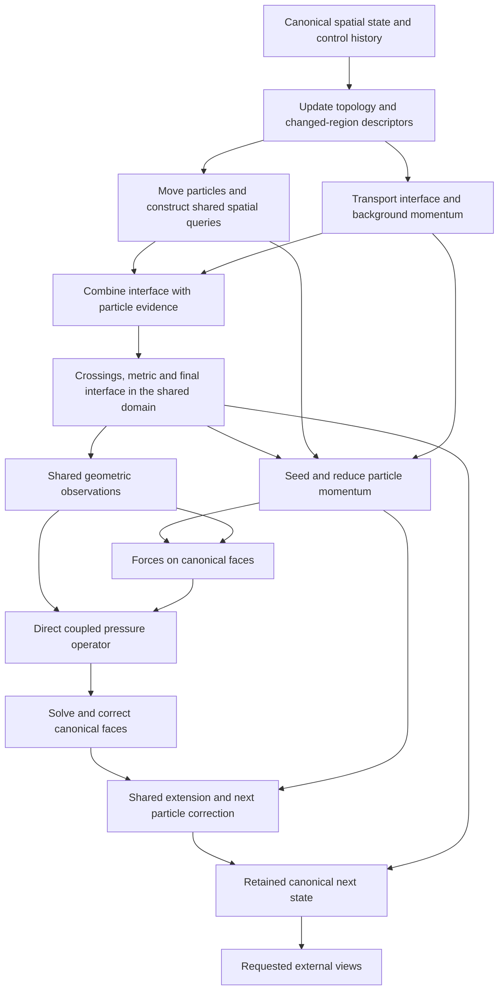

# Narrow-band FLIP as a data transformation

This is the starting point for architectural optimization: first the algorithm, then its mathematical dataflow, then equivalent rewrites that remove work. Kernel tuning and occupancy are not the organizing model.

The subsequent [experiment record](nbflip-data-transform-experiments-2026-10-20.md) tracks measured rewrites, failed hypotheses, adaptations and the pressure deletions, canonical surface publication and removal of unused particle norm work now integrated in the product.

The reference is the 3D NB-FLIP implementation at `4acecd97`. The subsequent `660c13a1` and `b474edb6` commits do not change the inspected solver files. This describes the implemented adaptive method, including its boundary, particle-lifetime, surface-coupling, cold-region and pressure policies; it is not a substitution of the paper's shorter equations. The default FLIP path is the main case. APIC substitutes its affine particle transfer while retaining the surrounding dependencies.

## 1. What one timestep does

At a high level, the method evolves **an interface, grid velocity, and a band of particles**. Grid transport carries the bulk flow. Particles preserve detail near the interface. Pressure makes the combined velocity satisfy the incompressibility and boundary constraints.

| Step | What it does | Why it exists |
|---|---|---|
| 1. Prepare the spatial domain | Decide where storage and fine resolution are needed; account for moving solids, inflows and predicted motion; transfer values when ownership changes | All subsequent queries must have valid data, including across resolution boundaries |
| 2. Prepare the old velocity field | Extend the prior velocity into the region transport will sample, reusing the preceding tail when valid | A trajectory may sample outside currently liquid cells |
| 3. Update and move particles | Apply the preceding grid correction to coupled particles, handle ballistic particles, integrate trajectories and collisions, retire particles, and build spatial ranges | Carry surface-scale momentum and place particles where their contributions belong this step |
| 4. Transport the interface | Backtrace the old level set through the old velocity | Carry interface information that particles do not fully determine |
| 5. Reconstruct the interface | Combine the transported field with the moved particles, sources, occupancy limits and activity rules; clear certified stale air regions | Produce the represented liquid surface used by the rest of the step |
| 6. Restore distance information | Find crossings and nearby candidates; handle coarse retirement; compute the metric field and update permitted interface magnitudes | Supply particle membership and transfer depths without disturbing protected interface values |
| 7. Derive geometry | Determine liquid amounts, open faces, interface fractions and boundary information from the new surface and solids | Define the new transport/pressure geometry |
| 8. Form transported momentum | Advect background grid momentum; seed deficient particle regions; deposit particle momentum and blend it with the grid | Combine bulk transport and particle-carried detail |
| 9. Apply forces | Add gravity, source effects and enabled constitutive terms, respecting boundaries | Form the velocity to be projected |
| 10. Solve pressure and project | Build a coupled fine-band/coarse-interior system, warm-start and solve it to the implemented acceptance policy, then correct velocity | Enforce the discrete fluid constraints |
| 11. Prepare the next particle correction | Extend the pre-force/pre-pressure and final velocities consistently; record the correction particles will use next step | FLIP must measure physical changes, not differences caused by inconsistent air extrapolation |
| 12. Commit the next state | Retain useful geometry/support, publish required views, update control history and receipts; couple bodies when enabled | Make the next step and external readers see a coherent state |

The order contains real dependencies. The moved particles contribute to this step's surface; the new surface determines pressure geometry. Newly seeded particles are appended **after** surface reconstruction, outside the sorted runs: they contribute to next-step residency prediction immediately, but enter surface/deposit/seam queries after the next movement and filing. The pressure correction is consumed by particle G2P at the following head. These facts constrain fusion and reordering.

Initialization also performs bootstrap seeding and a projected half-step kick. A fully certified idle frame can retain its state. These are branches of the same state machine, not steady-state work to charge to every active frame.

## 2. A formal state and transformation

### 2.1 Logical state, independent of storage

Let the timestep be the function

\[
 S_{n+1}=T_{\Delta t,I_n}(S_n),
\]

where external inputs \(I_n\) include sources, solids/body motion, parameter changes and requested observations. Use the following logical state:

\[
 S_n=(\tau_n,\phi_n,d_n,u_n,\mathcal P_n,\delta_n,p_n^{warm},\mu_n).
\]

| Symbol | Meaning |
|---|---|
| \(\tau\) | Spatial topology: resident domain, h/4h ownership, boundaries and adjacency |
| \(\phi\) | Represented interface field, including its magnitude rules and hanging-vertex interpretation |
| \(d\) | Metric/depth field and associated crossing/candidate information used by particle membership and transfer |
| \(u\) | Physical velocity on canonical simulation faces, including the decoding of frozen-region terms |
| \(\mathcal P\) | Particle records: position, velocity, lifetime/heat, coupled/ballistic mode, and APIC affine state when applicable |
| \(\delta\) | Particle-specific retained FLIP correction, with validity/PIC-fallback information |
| \(p^{warm}\) | Pressure state needed for the next warm start |
| \(\mu\) | Persistent control state: activity, freeze state, revisions, residency predictions, volume budget, receipt history, allocation/generation state and relevant time |

Derived arrays are not automatically part of the essential state. An array is essential only if it cannot be regenerated from this state without changing a future observable. A retained cache can still be needed operationally; it carries a certificate of the state from which it was derived.

**Two important non-identities:**

\[
 \phi \ne d, \qquad u_{before}\ne u_{after}.
\]

Fine redistance protects interface vertices while the metric bank remains available to `particleDepth` and `transferProperties`. Eliminating distance work merely because `arenaStore` does not write that vertex is therefore invalid. Likewise, discarding the old velocity reference would change FLIP. A unified representation means common spatial identity and access rules, **not collapsing distinct physical quantities**.

### 2.2 Fields are functions; buffers are representations

For a topology \(\tau\), define vertex, cell and face domains \(V_\tau,C_\tau,F_\tau\). Logical fields have types such as

\[
 \phi:V_\tau\to\mathbb R,\qquad
 u:F_\tau\to\mathbb R,\qquad
 \mathcal P=\{(id_i,x_i,v_i,\ldots)\}_{i=1}^N.
\]

The actual sampler is part of the field's interpretation. For example, a hanging vertex may be a specified interpolation of authoritative coarse vertices rather than an independent degree of freedom. Negative boundary faces, solids and frozen-region terms also have explicit interpretations.

A physical layout \(L\) has a decoder \(D_L\) from its arrays to these fields. Correctness is about decoded queries and state transitions, not equal physical buffer offsets.

For a replacement implementation \(T'\), the central obligation is

\[
 D_{L'}\big(T'(E_{L'}(S),I)\big)=T(S,I)
\]

for all supported states and inputs, with the same specified floating-point/quantization contract. It must hold after every step, including control history, so the next step starts from an equivalent state. Matching one rendered frame is insufficient.

For experiments, distinguish:

- **Representation equivalence:** same logical values and decisions; preserve arithmetic order where exact comparison is intended.
- **Numerical equivalence:** a separately specified tolerance for outputs and subsequent trajectories. Reassociated sums or different interpolation weights require this contract.
- **Method change:** different particle density, surface rule, pressure acceptance or resolution policy. These do not qualify as deleting redundant work from the same transformation.

Particle storage order can be changed only after proving that all consumers, tie-breaking, seeding and accumulation rules respect that permutation. Fixed-point P2G sums are order independent, but its per-contribution quantization must remain before summation.

### 2.3 The timestep in dataflow form

The following functions denote the existing rules, not new approximations. Subscripts mark versions; a new version is produced only when a logical value changes. This is a dependency model, not an exact dispatch schedule: the implementation can prepare extension before census and reuse it after a certified remap. Each row also receives the relevant immutable parameters and control state; the table highlights its principal field dependencies.

| Transformation | Inputs → outputs |
|---|---|
| Domain decision \(C\) | \((S_n,I_n)\to(\tau',\mu_{head})\) |
| Ownership remap \(M\) | \((\tau_n,\tau',\phi_n,u_n,\mu_{head})\to(\phi_0,u_0,\mu_0)\) |
| Old sampling preparation \(E_0\) | \((u_0,\phi_0,\tau',I_n,\mu_0)\to\widehat u_0\), or reuse the certified result |
| Particle update/move \(A_P\) | \((\mathcal P_n,\delta_n,d_n,\widehat u_0,\tau',I_n,\mu_0)\to\mathcal P_m\), refreshing stale membership data first when required |
| Spatial indexing \(B\) | \(\mathcal P_m\to\mathcal B_m\): cell ranges, counts and particle query views |
| Interface transport \(A_\phi\) | \((\phi_0,\widehat u_0,\tau',I_n)\to\phi_a\) |
| Coupling/air policy \(C_\phi\) | \((\phi_a,\mathcal P_m,\mathcal B_m,\tau',I_n,\mu_0)\to\phi_c\) |
| Search/retirement/distance \(R_\phi\) | \((\phi_c,\tau',\mu_0)\to(\phi_f,d_f,\mathcal X_f,\mu_\phi)\) |
| Geometry \(G\) | \((\phi_f,\tau',I_n,\mu_\phi)\to\mathcal G_f\) |
| Grid momentum transport \(A_u\) | \((u_0,\widehat u_0,\tau',I_n,\mu_\phi)\to u_a\) |
| Seeding \(Z\) | \((\mathcal P_m,\mathcal B_m,\phi_f,d_f,\widehat u_0,I_n,\mu_\phi)\to(\mathcal P_m,\mathcal P_{seed})\); appended seed/slab records remain outside filed query runs |
| Particle transfer/blend \(D\) | \((u_a,\mathcal P_m,\mathcal B_m,\phi_f,d_f,\mathcal G_f,\mu_\phi)\to u_b\); classification and residency prediction also consume the separate seed/spill population, producing \((\mathcal P_{n+1},\mu_D)\) |
| Forces \(F\) | \((u_b,\mathcal G_f,I_n,\mu_D)\to u_*\) |
| Pressure construction \(K\) | \((u_*,\phi_f,\mathcal G_f,\tau',\mu_D,I_n)\to(A,b,\text{boundary/acceptance data})\) |
| Pressure solve \(\mathcal S\) | \((A,b,p_n^{warm},\mu_D)\to p_f\) and convergence/control state |
| Projection \(\Pi\) | \((u_*,p_f,\mathcal G_f,\tau')\to u_f\) |
| Paired extrapolation/correction \(L\) | \((u_b,u_f,\mathcal P_{n+1},\mathcal G_f,\tau',\mu_D)\to(\widehat u_f,\delta_{n+1})\) |
| Commit \(Q\) | These results → \((S_{n+1},\text{requested presentation/receipts})\) |

\(R_\phi\) includes the actual internal ordering: crossing search, coarse retirement, refreshing affected represented values, metric evaluation, protected fine stores and resolved reads. It cannot be replaced by an unspecified exact signed-distance transform: the current candidate selection and zero-set rules define its answer.

Similarly, \(\mathcal S\) is the implemented finite multilevel iteration with warm starts, wall active sets, residual gates and held regions. Writing \(p=A^{-1}b\) would erase behavior that affects both cost and the next state.

### 2.4 The core reductions

For a canonical face \(f\), the particle-transfer reduction has the shape

\[
 m_f=\sum_{i\in N(f)}Q_m(w_{if}v_{i,f}),\qquad
 w_f=\sum_{i\in N(f)}Q_w(w_{if}),
\]

followed by decoding and the existing depth/activity/occupancy blend with \(u_a\). \(Q_m,Q_w\) are the existing fixed-point quantizers. The kernel's atomics and temporary windows implement this reduction; they are not the reduction's mathematical definition.

For a coupled particle, the conceptual FLIP/PIC update is

\[
 v_i^+=(1-\alpha)\,\widehat u(x_i)
       +\alpha\,(v_i+\delta_i),\quad \alpha=0.95,
\]

with the implementation's component validity, PIC fallback, mode, source, lifetime and collision branches. This identifies what is consumed without claiming those branches can be dropped.

The pressure system couples h-band rows and native 4h interior rows. Restriction, prolongation and fine/coarse flux coupling are mathematical operators in this transformation. The *arrays used to present the same fields to them* are separate implementation choices.

## 3. Where the current representation creates work

The physical pipeline is larger than the logical graph because several stages require different stored versions of the same logical quantities:

| Logical object | Physical forms/paths in the current implementation |
|---|---|
| Spatial identity | Page directory, h/4h owner maps, rebuilt particle/surface brick lists, pressure-arena slots and stage-specific descriptors |
| Interface | Live canonical field, advected scratch, resolved hanging values, 9³ surface-arena windows, coarse publication and pressure geometry views |
| Distance/crossings | Vertex-keyed metric words, tile crossing masks/reach, nearest-cell banks and brick-local work windows |
| Velocity | Physical face fields, retained old face slots, paired extension slots, hierarchy values, fine halo taps, coarse sampling cache, pressure-layout fields |
| Particles | Current/scratch records, brick slabs, cell ordering, compact position/motion views, counts and support/refinement summaries |
| Pressure | Root presentation/warm-start arrays, band/native rows, hierarchy correction planes, simulation projection outputs |

A single buffer shared by several stages does not imply one representation. The shared brick table is rebuilt and slot identities can change; it is presently an execution index, not a permanent home for all state.

The architectural target is to remove the **representation-adapter subgraphs** between logical operations, then remove computations proven dead by their downstream observations. Simply staging more data in workgroup memory leaves the graph intact.

## 4. A unified representation

Use one versioned spatial domain with typed degrees of freedom:

\[
 \mathcal U=(\mathcal B,\operatorname{owner},\operatorname{adj},
              \operatorname{views},\operatorname{channels},\operatorname{versions}).
\]

- **Stable brick identity:** world brick coordinate plus generation; an allocated slot is a location, not its identity. Retained bricks keep their slots. Changed-domain lists handle entering/leaving bricks.
- **Canonical ownership:** every independent vertex, face and cell value has one authoritative key. Shared faces/vertices have a deterministic owner. Coarse/fine interface values have explicit reconstruction recipes.
- **Direct adjacency:** neighbour handles and coarse/fine relation records are resolved once per topology generation, outside field-stencil loops.
- **Separate semantic channels:** interface, metric, velocity epochs, pressure, solid measures and activity remain distinct. Channels use the same spatial key system and local ordering.
- **Query views:** point samples, coarse observations, face restrictions and particle cell ranges are views over that domain. Materialize a view only when reuse pays for it; a GPU texture view may remain worthwhile for hardware interpolation.
- **Versioned derived data:** a view records precisely which topology, field, solid and parameter epochs it consumes. A cache hit means equality of dependencies, not merely “the region was quiet.”

The allocation granularity can initially be the existing 8³-cell brick. That is an implementation starting point, not a proved optimal size. A universal dense halo is not required. Canonical values plus compact seam/halo views avoid replicating every field at every boundary.

Particle records remain a separate population indexed by this same domain. Pressure's coarser levels remain numerical auxiliary domains linked by explicit operators. Unification does not require a particle to be a grid cell or every multigrid level to have the same resolution.

## 5. Equivalent rewrites that can delete whole paths

### Rewrite A — Replace intermediate field publication with a shared field view

Let \(H_\tau\) reconstruct resolved/hanging observations from authoritative interface values. Under fixed topology it is a consistency projection: already-consistent observations do not change when resolved again. A current chain has the form

\[
 f\;\to\;\operatorname{materialize}(H_\tau\phi)
 \;\to\;\operatorname{gather}_{arena}
 \;\to\;g.
\]

Define the new consumer by composition:

\[
 g'(\phi)=g\big(\operatorname{gather}_{arena}(H_\tau\phi)\big).
\]

Store \(\phi\) once in \(\mathcal U\); implement \(g'\) using direct local offsets and precompiled seam recipes. Consecutive consumers share the same versioned view. The equation establishes the required output, without requiring the intermediate textures/windows to exist.

**Delete candidates:** global resolve materializations whose readers have migrated; canonical-to-arena gathers; arena-to-canonical conversion; coarse mirrors used only to recover the same interface observations. Physical redistance updates and the metric channel remain.

**Important condition:** this is not `resolve(A); resolve(B) → resolve(A+B)`. A producer between resolves changes the field version. Its next consumer must see \(H_\tau\) of the new version. Lazily evaluating the correct view preserves that dependency; reading stale hanging values does not.

**First complete experiment:** migrate a surface segment from coupled canonical phi through search/metric/final phi **and its first particle/geometry readers**. Time entry conversion, all work, and any exit bridge. A prototype that skips `arenaStore` while the rest of the solver still reads the old texture is invalid.

### Rewrite B — Build and apply pressure directly on the canonical face domain

Name the current adapters:

- \(R\): present simulation fields in the pressure/root representation;
- \(K_p\): construct pressure rows/RHS from that presentation;
- \(J_p\): apply the solved correction there;
- \(S_{u_*,\mathcal G,\mu}\): map the corrected result back to simulation, including retained simulation values, fine-band projection, fine/coarse and boundary rules, and frozen-region state updates. These retained arguments matter: the root projection alone is not the complete simulation field.

The current observable pressure transformation is

\[
 (u_f,\mu_f)=S_{u_*,\mathcal G,\mu}\big(J_p(R(u_*),p_f),p_f\big),
 \qquad p_f=\mathcal S(K_p(R(u_*),\phi_f),p^{warm}).
\]

Construct direct operators

\[
 K_{direct}=K_p\circ R,\qquad
 J_{direct}(u_*,p,\mathcal G,\mu)
 =S_{u_*,\mathcal G,\mu}(J_p(R(u_*),p),p).
\]

Evaluate them from canonical face/geometry records, without first writing \(R(u_*)\) and later copying the projection back. Keep exactly the same coupled matrix, RHS, warm start, coarse correction and boundary behavior in the first experiment.

**Delete candidates:** simulation-to-pressure field materialization, root owner/field mirrors needed only by that materialization, redundant authority scratch, projected-root texture publication, pressure-to-simulation transfer, and a presentation-to-warm-start copy when both can reference the retained pressure plane.

**Not deleted:** native coarse rows, multigrid levels, interface couplings or the pressure solve. In general, divergence, geometry classification and restriction do not commute. The direct operator must reproduce the composition, not replace it with an intuitively similar average.

**First complete experiment:** compare direct and current `(matrix coefficients, RHS, warm start, projected canonical faces)` on frozen states; then compare residual histories and full evolving frames. This is a pressure-chain experiment, not a `pRelax` cache experiment.

### Rewrite C — One particle index and one set of reductions

Let \(\pi\) be the existing cell-order permutation. The current implementation materializes ordered records \(P[\pi]\) and additional position/motion views. Any consumer \(g\) can formally be written

\[
 g(P[\pi])=g_\pi(P),
\]

where \(g_\pi\) traverses cell ranges and accesses records through the same permutation. This makes full-record sorting a representation choice, not a mandatory mathematical stage.

Candidate representation: stable brick-local particle records, one cell prefix/range index, and compact channels shared by surface and momentum consumers. Compare an indexed view against moving the full records. Preserve the per-cell traversal order where floating-point or tie rules require it.

At the final classification point, form shared reductions over the same accepted particle set:

\[
 (\text{counts},\text{support},\text{motion bounds},\text{refinement evidence})
 =\operatorname{reduceBySpatialKey}(\mathcal P_{n+1}).
\]

Their algebraic reducers may differ; their particle enumeration and spatial lookup need not be repeated. A compact position channel can remain if several consumers benefit from it; it should be the shared query representation, not one more private copy per stage.

**Delete candidates:** repeated full-record reorder/materialization, repeated cell-count scans, repeated extraction of positions/motion, and repeated spatial resolution for summaries.

**Dependency condition:** moved-particle counts used by surface reconstruction precede seeding. Momentum deposit still uses the filed runs; post-classification refinement additionally visits appended seeds/spill. These are different populations and epochs. They cannot all be replaced by one early count or fused blindly into particle movement. However, deposit and the filed-particle portion of refinement can share one traversal if prediction consumes the newly computed support mode; the seed/spill tail remains separate.

**First complete experiment:** move → indexing → surface contribution → P2G → refinement evidence. Savings in sorting alone do not count if every later consumer pays more indirection.

### Rewrite D — Compute only intermediates that can affect the result

For a composition \(y=g(f(x))\), let \(Q_g\) be the exact set of observations of \(f(x)\) needed by \(g\). If \(\widehat f\) produces the same answers on \(Q_g\), then

\[
 g(f(x))=g(\widehat f(x)).
\]

Apply this as backwards dependency analysis over the **whole timestep and retained next-step state**:

1. Start with final canonical phi/velocity, particle records, pressure warm state, control state and requested presentation.
2. Follow each observation backwards to its producer and interpolation stencil.
3. Union demands from all consumers, including future membership, seeding and remap certificates.
4. Compute that closure; values outside it are dead for this transition.

Promising targets are distance vertices, coarse/hanging materializations, expensive interface traces whose results are provably overwritten, and helper fields used only by a soon-to-be-removed adapter.

**Two rejected shortcuts:** a vertex protected from phi redistance can still need metric depth; a particle-covered vertex can still depend on advected phi through bulk depth, occupancy bounds, slack and blending. Neither is a valid blanket skip mask.

The demand mask itself has a cost and may become nearly full in a dense splash. The experiment must measure the eliminated work and the cost of proving it unnecessary.

**A concrete consumer test:** `transferProperties` samples face depth, tests whether it is in \([-2,1.5]\), and only then uses its value for the blend's expected particle mass. Its local observation is

\[
 q_T(d)=
 \begin{cases}
  \text{inactive},&d<-2\ \lor\ d>1.5,\\
  (\text{active},\max(1,8\,\operatorname{clamp}(0.5-d,0,1))),&\text{otherwise}.
 \end{cases}
\]

A certified interval entirely outside that range is sufficient for this consumer; an exact distance is unnecessary **for that observation**. But its depth is an interpolation of nodal values. Clamping each nodal distance before interpolation generally changes the answer. Moreover, `arenaStore` can write the full nodal metric into future phi; seeding, particle movement and particle census also read depth. Therefore a transfer-only certificate does not justify removing the nodal metric computation globally.

The rigorous reduction criterion is observational equivalence. For all remaining consumers \(Q=\{q_1,\ldots,q_k\}\), define

\[
 z\sim_Q z'\iff \forall j,\ q_j(z)=q_j(z').
\]

An intermediate can be replaced by a smaller summary only if its consumers factor through that summary: \(q_j=\bar q_j\circ \sigma\). For distance, the summary might be a certified interval plus exact values for unresolved queries. The experiment must first establish whether the **union** of consumers leaves many such opportunities. Current nearest-box pruning already avoids some candidate solves; it must remain in the baseline.

### Rewrite E — Share the operator, not just the buffer

For fixed topology, support and boundary data, suppose extrapolation is the affine map \(E(u)=Lu+c\). Then

\[
 E(u_f)-E(u_b)=L(u_f-u_b).
\]

This identifies an opportunity to apply common geometry/address operators to current velocity and correction rather than build two independent representations. It is conditional: value-dependent validity, normalization, clamping or changed support can invalidate the affine assumption.

The current solver already sweeps old/current payloads together and records a swept particle delta. Therefore “pair the extensions” is not a new gain. Remaining opportunities are to share the canonical face representation and eliminate its retain/publication/conversion paths, preserving all current validity decisions. There is no automatic 2× extension saving left to claim.

## 6. The simplified target graph

The physical transformations remain recognizable. The simplification is that the intermediate arrows carry logical views in one spatial domain, rather than trigger copies into a new owner system. A stage obtains a brick once and uses direct local offsets; exceptional coarse/fine relations are explicit records, not repeatedly rediscovered by field-specific helper walks.

A cost model for this graph is

\[
 C'=C_{required\ math}+C_{shared\ topology}+C_{necessary\ views}
    +C_{changed\ region\ updates}+C_{external\ publication}.
\]

The proposed saving is the removed materialization/reclassification work plus any computation proven dead. It is not a multiple inferred from occupancy.

## 7. What is justified now, and how to de-risk it

The historical late-pour profile assigns about **2.81 ms** to five phi resolves, two arena gathers and arena store combined, within a 14.44 ms surface group. Pressure transfers to/from the root total about **0.69 ms**; pressure authority adds 1.53 ms but contains required work as well as representation work. These are gross times of affected passes, not recoverable savings, and cannot be added to claims that already include them. Removing visible copies alone is not evidence for a 2× frame speedup. Larger gains require eliminating repeated access/geometry work inside consumers or proving substantial mathematical work dead.

The initial local experiments reinforce that distinction: staging particle packets for destination gathering was substantially slower than the existing scatter; a tile-local pressure iterate did not reliably improve its stage. Those variants are excluded from the proposed product change. No production kernel tuning is being carried forward from this investigation.

The next experiments should follow this order:

| Order | Complete transformation under test | What must disappear | Equality/acceptance evidence |
|---|---|---|---|
| 1 | Surface canonical field → final phi/metric → first particle and geometry readers | Repeated resolves and arena/canonical conversions | All demanded scalar queries, interface zeros, metric depths, cold/seam behavior and revision outputs |
| 2 | Canonical forced faces → pressure rows/solve → canonical corrected faces | Root field mirrors and two-way transfers | Same rows/RHS, residual history, warm start, boundary flux and projected values |
| 3 | Particle move → spatial queries → surface and momentum reductions | Full-record sorting/copying and duplicate query views where unnecessary | Same accepted particles, cell ranges, reduction results, seed decisions and next-frame evidence |
| 4 | Backwards demand closure over those simplified chains | Unobserved traces, distances, field regions and helpers | Same final state and future-query results; measure conservative overcoverage |

Each experiment has three measurements: current chain; replacement chain including bridges; replacement with consumers using the unified representation. The difference between the last two quantifies migration cost. A production switch requires the replacement including all still-needed bridges to win on late pour and independent workloads.

Before implementation, enumerate each deleted array's readers and prove either that they moved to an equivalent view or that their observation is dead. That deletion ledger is the mechanism for cutting large swathes of work safely. It also prevents counting a removed gather, store or address walk more than once.

### Initial deletion ledger

These are source-backed obligations for the prototypes, not completed deletion proofs.

| Stored intermediate or repeated work | Readers/observable obligations | Proposed replacement and deletion gate |
|---|---|---|
| Resolved hanging phi after each mutation | The next transport, coupling, crossing, membership and geometry queries | A versioned canonical phi sampler. Remove a resolve only after every reader of that version uses the equivalent sampler |
| Surface arena 9³ copied phi windows | Crossing tests, distance candidate corner values and fine-store old-value comparisons | Shared brick field channels with seam recipes. Preserve pre-retirement versus post-retirement versions and the current crossing-search reuse rule |
| Arena-to-canonical fine publication | Geometry, particle queries and next-frame phi transport, plus change/revision tracking | Final phi is already in canonical channels. Only the conversion disappears; protected writes and revision decisions still execute |
| Pressure/root velocity and owner mirrors | Root authority, RHS, composite row setup, root projection, frozen correction accumulation and return transfer | Direct canonical restriction/geometry/project operators, retaining the native coarse numerical domain. Compare the complete pressure-chain outputs and control updates |
| Presented-pressure-to-warm-start copy | Next solve initialization; presentation readers may still need the last completed pressure | Retain solver pressure as the warm state; expose a read view or snapshot with explicit lifetime. Delete the copy only if simultaneous readers remain valid |
| Reordered complete particle records | Cell-run surface queries, P2G, seeding holes, refinement evidence and next movement | Stable records plus an ordered index or shared compact channels. Establish permutation invariance or reproduce the same traversal and identity rules |
| Repeated particle count/support reductions | Pre-seed surface coupling and post-seed transfer/classification use different populations | Share enumeration only within matching particle epochs; update changed ranges if that is cheaper than rebuilding |
| Nodal metric computations | Fine phi stores, particle membership, seeds, face blend weights and census | Backward demand closure and sufficient query summaries. No blanket deletion is justified by the current consumer audit |

The first architectural bet is therefore **one spatial field domain feeding surface, geometry and pressure through explicit query operators**. Particle indexing joins that domain without forcing particles into grid storage. This can delete several entire adapters and their private address/ownership machinery. Whether it also eliminates a large fraction of the expensive mathematical work remains an experimental question; this analysis does not yet establish a large frame speedup.

## Source anchors

- [Complete frame order](../../lib/methods/uniform/uniform-mixed-frame.ts): `advance`, `encodeParticleMomentum`, `encodeRelayoutHead`.
- [Particle and surface orchestration](../../lib/methods/uniform/uniform-narrow-band-flip.ts): `move`, `transfer`, `retire`, `redistance`, `recordDelta`.
- [Actual surface coupling rule](../../lib/methods/uniform/uniform-narrow-band-surface.wgsl.ts): `particleSurfaceBulk`, `particleSurfaceFinish`.
- [Metric consumers](../../lib/methods/uniform/uniform-narrow-band-membership.wgsl.ts): `particleDepthIn`; also `transferProperties` in the surface source.
- [Surface arena and protected writes](../../lib/methods/uniform/uniform-surface-brick-arena.wgsl.ts): `arenaGather`, `arenaDistance`, `arenaStore`.
- [Coupled pressure implementation](../../lib/methods/uniform/uniform-pressure-arena.ts): native/fine rows, iterative planes, hierarchy and projection.
- [Existing paired extension](../../lib/methods/uniform/uniform-mixed-extension.ts): `retainPair`, `preparePair`, `finishPair`.
- [Rebuilt brick slot identity](../../lib/methods/uniform/uniform-brick-table.ts).
- [Hardware, recorded timings and fresh utilization evidence](nbflip-hardware-stage-analysis-2026-10-20.md). Those counters explain resource behavior; they do not establish an equivalent algorithm rewrite.
