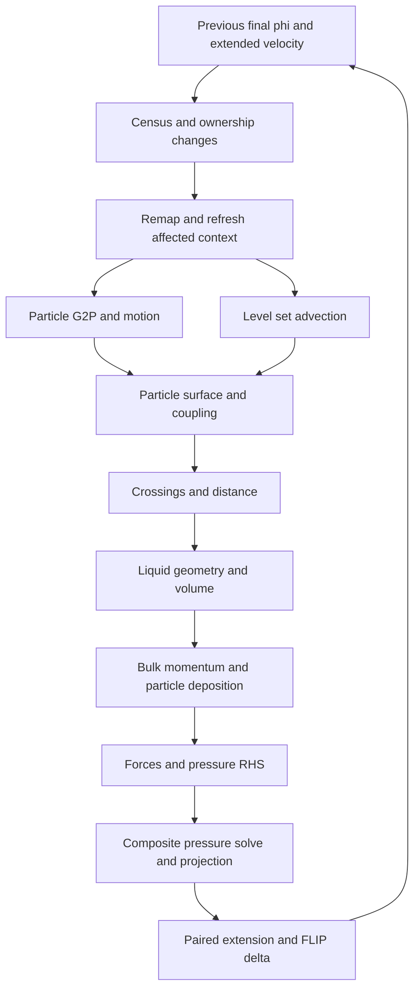

# NBFLIP hardware utilization and stage data layout plan

**Architecture starting point:** [Narrow-band FLIP as a data transformation](nbflip-formal-dataflow-2026-10-20.md) now defines the complete stage summary, formal state, equivalent rewrite candidates and deletion obligations. This document preserves hardware and profiling evidence, plus earlier exploratory layout hypotheses. Those hypotheses are not accepted product changes; the formal analysis supersedes their implementation priority.

The optimization target is the Figure 7 pour **after bottom impact**, including the growing pool and the later particle churn. The strongest design is a shared, persistent ownership system with different execution layouts for different stages: compact fine-tile lists, brick-bucketed particles, direct stencil channels, and hardware-filtered velocity atlases. A single large workgroup window for every stage is already contradicted by measurements.

This analysis distinguishes measured hardware rates, recorded timings, hardware counters, and proposed algorithms. It does not treat a high ALU percentage as the objective. The objective is minimum time for the required physical result, with the limiting resource efficiently used and little work on irrelevant elements.

The implementation reference is committed snapshot `7f8a2876`, captured before the diagnostic run. It includes trilinear fine-phi advection, zero extra fine-grid padding, three band cycles, two pressure iterate planes, and the swept FLIP delta. Other work in the main checkout is outside this snapshot.

## Algorithm shape and locality: the organizing model

Choose the mathematical work and its ownership first, then the stored representation, then the execution schedule. Dispatch count and occupancy are diagnostic consequences. They are not the basis for choosing a representation.

| Stage / access pattern | Present repeated work | Shape to test | Locality / reuse claim | Full cost to benchmark |
|---|---|---|---|---|
| Census and region classification: reductions | Several consumers reread phi, speed and particle evidence | Versioned summaries produced at field writers | Read each field once, reuse a small conservative record | Writer additions + summary update + all consumers |
| Ownership changes: sparse remap | Resolve the same source/destination topology for several fields | Explicit changed-owner jobs with stable source/destination descriptors | Resolve address once per region, stream its field planes | Job construction + remap + generation maintenance |
| Particle motion: repeated spatial interpolation | Each integration sample resolves neighbours and gathers nearby velocities | Spatial particle ranges plus a compact velocity apron, with explicit exceptions | Reuse velocities and addresses among particles of one region | Apron construction + motion + fallback + bin publication |
| P2G: many-to-few reduction | Each particle scatters 81 contributions to local MAC nodes | Compare existing local scatter with destination-owned gathering from staged cell runs | Exchange per-contribution atomics for local sequential reads; this may lose if repeated reads/math exceed atomic cost | Particle staging + classify + reduction + flush, including dense-tile fallback |
| Surface coupling: neighbourhood queries | Nearby vertices visit overlapping particle ranges and phi corners | Vertex/particle packets sharing cell offsets and immutable phi neighbourhoods | Reuse particle positions and phi among nearby output vertices | Packet construction + all predicates + coupling + canonical writeback |
| Redistance: repeated candidate evaluation | Several vertices fetch the same crossing cell's eight corners and evaluate the same field | Crossing-cell records with contiguous corners/coefficient data and candidate-pair lists grouped by crossing cell | Load candidate data once per group, solve several query points | Record build + pair grouping + exact solve + per-vertex minimum + store |
| Forces and geometry: stencil + transform | Repeated solid apertures, face classification and owner resolution | Direct face records; separate static solid from changing liquid geometry | Stable solid/topology data reused across consumers and frames | Invalidation + rebuild + forces/geometry + legacy publication |
| Pressure: repeated sparse stencil | Each relaxation row rereads neighbouring iterates from global planes | Tile-local iterate packets; direct external neighbours; later test compact reusable row records | Load the tile's old iterate once; reuse it for red/black updates; external faces keep the original source plane | Tile staging + relaxation + output, then whole hierarchy to the same residual |
| Extension: repeated frontier stencil | Similar addressing for old/current fields and repeated inactive regions | Paired field channels and an explicit valid frontier | Reuse address resolution, touch only required cells | Frontier construction + both fields + completion/publication |
| End-stage publication: representation conversion | Arena, canonical fields, caches and renderer copies may coexist | One authoritative representation per value, explicit derived views | Remove a copy only when its last consumer has migrated | Complete producer → consumer chain, including renderer |

For every cached shape, record **useful bytes, loaded bytes, number of reuses, neighbour/exception fraction, and rebuild frequency**. The break-even condition is `build + consume + publish < current chain`, at the same required physical result. A local packet that rereads every particle many times is not automatically better than an atomic scatter. A larger apron that mostly serves coarse or unused cells is not automatically better than selective gathers.

The initial experiments used the same frozen GPU inputs and exact comparison of every written buffer word. Destination-owned P2G gathering was substantially slower than the existing scatter; tile-local pressure packets showed no reliable improvement. Workgroup-size controls did not establish a worthwhile whole-frame gain. These approaches are not being carried into the product. The next experiments instead test removal of complete representation-adapter chains, as specified in the formal analysis.

## 1 Hardware and the meaning of full utilization

The local machine reports an Apple M1 Max with **32 GPU cores, 10 CPU cores and 32 GB unified memory**. Apple's published memory bandwidth is **up to 400 GB/s**. Unified memory removes the PCIe transfer problem; it does not make random GPU accesses equivalent to contiguous ones. [Apple M1 Max announcement](https://www.apple.com/newsroom/2021/10/introducing-m1-pro-and-m1-max-the-most-powerful-chips-apple-has-ever-built/)

The recent hardware document is [m1-max-measured-ceilings.md](/Users/petersuggate/.claude/projects/-Users-petersuggate-code-me-fluid/memory/m1-max-measured-ceilings.md). Its original microbenchmark and JSON survive in the prior session's scratch directory. A small local copy of the results and provenance is in [hardware-ceilings.json](../benchmarks/nbflip-stage-analysis-2026-10-20/hardware-ceilings.json).

| Resource | Measured reference rate | Consequence for this solver |
|---|---:|---|
| Contiguous reads | 359.3 GB/s | Use for stream and reduction traffic estimates |
| Contiguous copies, counting reads plus writes | 375.8 GB/s | Count both sides of every copy |
| Random scalar loads within 4 KB windows | 33.68 billion/s | Spatial order matters even when data is cached |
| Random loads over 4 MB | 15.52 billion/s | A useful reference for medium working sets |
| Random loads over 32 MB | 6.90 billion/s | Large gather-heavy fields have a much lower rate |
| Random loads over 256 MB | 0.75 billion/s | Whole-domain pointer chasing can be extremely expensive |
| Workgroup memory reads | 718.6 billion/s | Valuable when many consumers reuse a small staged region |
| Device atomic additions | 5.70 billion/s | Avoid an atomic for every contribution when local reduction is possible |
| Workgroup atomics plus flush | 217.87 billion/s | P2G already uses this path; it is not an unclaimed 38× gain |
| FP32 FMA microbenchmark | 3.79 TFLOP/s | Achieved throughput of this particular kernel, **not the processor's maximum FP32 throughput** |
| Small pass or dispatch | About 2.3 µs | Fixed latency matters particularly in the pressure tail |
| Filtered rgba32f / rgba16f sampling | 13.5 / 28.4 billion samples/s | Recorded separately in the particle and surface plans; not in the recovered ceilings JSON |

The original benchmark takes the minimum of five repetitions, each containing ten dispatches. These are best observed reference rates, not universal upper bounds. A more coherent kernel can exceed the random-gather benchmark. The reported cache-size labels are benchmark working sets, not measurements of physical cache capacity. The FMA test is described as latency limited; pricing all math at 3.79 TFLOP/s would overstate the minimum necessary time.

A fresh adapter query gives these WebGPU limits:

| Limit or feature | Exposed by this adapter |
|---|---:|
| Workgroup storage | 32,768 bytes |
| Invocations per workgroup / maximum X dimension | 1,024 / 1,024 |
| Storage buffers per shader stage | 10 |
| Maximum buffer / storage-buffer binding | 4,294,967,295 bytes |
| Maximum 3D texture dimension | 2,048 |
| Subgroups, shader f16, float32 filtering, timestamp queries | Available |

These are adapter maxima; a device must request the needed limits/features. See [adapter-limits.json](../benchmarks/nbflip-stage-analysis-2026-10-20/adapter-limits.json) and `requiredFluidDeviceLimits` in `lib/core/webgpu-device-limits.ts`. Larger workgroups are not automatically faster.

### What we should maximize

There are four different questions:

1. **Timeline activity:** how much of the frame has useful GPU work available?
2. **Occupancy:** how many threads are resident relative to the hardware's capacity?
3. **Resource utilization:** how busy are ALUs, texture sampling, buffers, and shared memory?
4. **Useful throughput:** how many required particles, faces, rows, or vertices are completed per millisecond?

High occupancy can coexist with stalls or wasted work. High ALU utilization can be mostly address arithmetic. A memory-limited copy should approach its memory rate without filling the ALUs. Apple also distinguishes utilization from limiter counters: a resource can constrain execution without all arithmetic pipelines being fully occupied. [Apple GPU counter interpretation](https://developer.apple.com/videos/play/wwdc2020/10603/)

For each kernel, model:

```text
resource service estimate =
  max(bytes / stream rate,
      gathers / applicable gather rate,
      filtered samples / sample rate,
      local atomics / local atomic rate,
      global atomics / global atomic rate,
      arithmetic / applicable arithmetic rate)

kernel estimate must also account for:
  dependency depth, insufficient independent work, barriers,
  address/control instructions, register pressure, and launch latency
```

The maximum avoids charging overlapping resource service twice. Sequential phases within a kernel may still add, and dependent kernels add along the critical path. Using measured reference rates makes this an engineering estimate; only genuine upper bounds on service rates yield strict lower bounds on time.

**100% utilization of every unit is neither possible nor necessary for this frame.** The small coarsest pressure solve cannot fill 32 cores without changing its algorithm or adding unrelated work. Its correct objective is low latency. For large kernels, optimize useful elements per second and time to the same answer.

## 2 What the recorded pour evidence establishes

### Physical windows and version boundaries

The scene is `nbflip-figure-7-pour`, 128 × 256 × 128 equivalent fine cells. The historical probes and new counter capture override the timestep to **1/60 s**. The scene itself is authored at **24 Hz**, and its source ends at **5.25 s** (126 authored frames). Changing the solver timestep does not rescale the inflow schedule: sampled frames 200–212 are 3.33–3.53 s and the source is still active. Frames 94–100 and 200–212 therefore cover different stages of impact/filling, not before/after source shutdown. A native-timestep frame number is a different physical time.

The source's release height and downward speed put unobstructed bottom arrival well before frame 94; this is a scene-scale check, not a measured first-contact timestamp. Future acceptance captures should record first contact explicitly rather than infer it from frame numbering.

The existing early profile is `part2h`; the old late profile is `late1`; a later four-cycle profile is `delta12`. None is today's unchanged implementation. The closest recorded parameter match is `armA16`, measured on `2f6b6d5f` with the three defaults subsequently adopted in `7f8a2876`.

### Stage time after impact

The following groups were recomputed from every saved pass label, with mutually exclusive classification. The exact rules, component passes, original paths, and source hashes are in [timing-evidence.json](../benchmarks/nbflip-stage-analysis-2026-10-20/timing-evidence.json). Group boundaries differ slightly from earlier prose tables; totals reconcile to the underlying JSON.

| Stage | Later four-cycle run, ms | Three-cycle trilinear run, ms | Largest remaining work in the latter |
|---|---:|---:|---|
| Surface | 17.85 | **14.44** | Distance 2.05; fine coupling 1.87; fine advection 1.64; deferred advection 1.38; store 1.13; resolves 1.09 |
| Particles including P2G and delta | 10.72 | **10.78** | Fast move 3.35; deposit 1.77; seam transfer 0.84; delta 0.81; sort 0.77; refine 0.72 |
| Pressure including authority and mirrors | 12.53 | **10.30** | Relax 1.61; authority 1.53; rows 1.44; coarse project 0.72 |
| Remap, geometry, forces, extension | 9.42 | **8.73** | Forces 1.58; remap faces 1.44; geometry 1.41; hanging taps 0.53 |
| Other including census and planning | 5.24 | **4.81** | Local speed 1.10; fine census classification 1.01 |
| Bulk momentum | 1.49 | **1.35** | Fine classify/sample 0.46; trace 0.39; finish 0.39 |
| **Sum from rounded pass labels** | **57.24** | **50.40** | |
| Mean recorded gaps between passes | 7.69 | 6.77 | Separate from the pass sum |
| Instrumented wall median | 68.02 | 60.51 | Not a clean UI/render frame time |

The three-cycle run has **1.275–1.341 million particles**, mean 1.318 million, and 335 dispatches. Its final receipt reports 8,723 fine tiles, 50,157 coarse tiles, 5,413 pressure-band tiles, and a 0.389 s⁻¹ band residual. Those are final values, not averages: saved `workDomainInfo` references repeat final values across earlier rows. Particle counts were separately copied as numbers and do vary by frame.

The final band residual exceeds the selected 0.05 s⁻¹ return threshold. The cycle cap is therefore part of the observed quality/performance tradeoff; it is not evidence of a fully converged solve.

Surface, particles and pressure account for about 70% of pass time. Surface alone cannot deliver a 3× frame improvement. Even deleting its entire 14.44 ms would leave about 36 ms of pass work.

The two-cycle arm is particularly informative: pressure falls to 8.78 ms, but surface rises to 16.21 ms and the total reaches 50.96 ms. Less accurate velocity increases deferred advection. The stage graph is coupled; savings from independently evolved runs cannot simply be added.

### Historical hardware counters

The recovered pour counter capture starts after 95 warmup steps and ran 104 more steps. It has no physical frame labels. Its manifest names `a24439e0` and a dirty tree. Its original reducer accepted overlapping device activity; this analysis reran the repository's stricter reducer, excluding mixed labels, observed foreign GPU overlap, and samples within a full 10 µs sampling period of a boundary.

| Label in that capture | Occupancy | ALU utilization | F32 utilization | Read / write GB/s | Coverage |
|---|---:|---:|---:|---:|---|
| Shared frame schedule, **many stages combined** | 15.21% | 24.97% | 2.30% | 10.50 / 4.48 | 99.9% exclusive interval coverage |
| Ownership residency | 19.02% | 35.01% | 0.06% | 50.56 / 0.06 | 100% |
| Layout build | 18.74% | 32.37% | 0.00% | 3.54 / 1.94 | 100% |
| Remap publish | 15.79% | 28.12% | 1.05% | 3.07 / 1.95 | 100% |
| Phi resolve | 30.58% | 44.46% | 1.59% | 11.63 / 0.51 | 100% |

The aggregate has roughly 38,000 ALU samples per hardware ring. Its ALU limiter is 27.40%, last-level-cache limiter 16.09%, and MMU limiter 7.28%. Ring means are equally weighted, not summed. The 10.50 GB/s read figure is about 2.9% of the contiguous-read reference, but **that ratio is not GPU efficiency**: the access patterns differ.

This establishes substantial unused arithmetic capacity during the observed mixed workload. It does not establish that every stage has the same limiter, nor that raising occupancy alone will recover the missing performance. Low FP32 activity alongside higher aggregate ALU activity is consistent with substantial non-FP32 work; instruction profiling is needed to quantify address arithmetic.

Crucially, the 11.8–18.8% occupancy and 19.7–35.2% ALU figures in the earlier surface plan come from the **letters scene**, not the pour. The recovered pour trace's coalesced label cannot replace missing per-stage counters. The complete reduction and original manifest are preserved in [historical-pour-counters.json](../benchmarks/nbflip-stage-analysis-2026-10-20/historical-pour-counters.json).

### Fresh late-frame counter capture

The new diagnostic captures **physical frames 201–212** of an isolated `7f8a2876` archive. It warms up 199 steps using normal coalescing, then separates encoders for attribution. The worker explicitly enables supported float32 filtering and resolves balanced product defaults. Frame 200 is excluded because capture starts partway through it. The frame-200 telemetry reports 1,077,379 particles and 4,451 pressure-band tiles; this is a different trajectory/version from the historical timing baseline.

The strict reducer rejects mixed labels, observed foreign GPU overlap, and samples within one full sampling period of boundaries. It retains 1,034,191 counter rows and rejects 974,764. Ring means are equally weighted. These are **pass-label measurements**, sometimes covering several kernels, not individual-instruction profiles. Encoder separation changes scheduling; these durations must not replace clean coalesced timing runs.

| Exact pass label | Compute occupancy % | ALU % | F32 % | Read GB/s | Write GB/s | LLC limiter % | MMU limiter % | ALU samples/ring | Exclusive interval coverage |
|---|---:|---:|---:|---:|---:|---:|---:|---:|---:|
| Uniform pressure arena solve | 25.58 | 21.91 | 0.78 | 45.88 | 5.41 | 29.77 | 16.52 | 1320 | 97.3% |
| Narrow-band FLIP transfer | 15.22 | 26.12 | 3.48 | 13.45 | 7.09 | 22.24 | 14.77 | 1001 | 89.8% |
| Narrow-band FLIP advectParticles | 11.87 | 22.80 | 1.35 | 14.82 | 6.75 | 23.11 | 7.01 | 941 | 82.5% |
| Narrow-band FLIP surface reconstruction | 19.41 | 32.01 | 3.81 | 5.94 | 0.72 | 14.54 | 4.30 | 789 | 92.3% |
| Uniform mixed surface advect | 12.32 | 23.33 | 1.51 | 14.04 | 5.36 | 25.31 | 8.01 | 626 | 92.8% |
| Narrow-band FLIP surface arena metric | 18.25 | 36.35 | 7.49 | 5.36 | 1.08 | 8.40 | 2.91 | 624 | 97.1% |
| Uniform pressure arena marks and rows | 12.35 | 25.69 | 0.64 | 6.83 | 11.00 | 17.84 | 7.23 | 422 | 100.0% |
| Uniform mixed extension | 18.78 | 25.90 | 0.79 | 8.41 | 7.34 | 19.82 | 5.46 | 381 | 95.4% |
| Uniform mixed body forces | 12.96 | 30.13 | 2.03 | 5.96 | 2.80 | 8.91 | 3.03 | 350 | 84.1% |
| Narrow-band FLIP surface arena store | 14.41 | 31.26 | 0.03 | 3.79 | 0.54 | 9.90 | 1.33 | 297 | 97.2% |
| Uniform mixed pressure project | 10.23 | 20.78 | 0.91 | 7.50 | 15.60 | 21.64 | 7.03 | 235 | 94.8% |
| Narrow-band FLIP snapshot | 25.99 | 51.86 | 5.58 | 43.55 | 19.61 | 38.61 | 19.09 | 218 | 97.7% |
| Narrow-band FLIP regional air update | 11.23 | 14.62 | 0.24 | 30.45 | 0.06 | 13.96 | 11.10 | 133 | 97.4% |
| Uniform mixed hanging fine taps | 32.63 | 46.07 | 3.01 | 23.12 | 22.65 | 22.22 | 14.27 | 134 | 98.2% |
| Uniform mixed phi resolve | 34.44 | 48.16 | 1.71 | 9.85 | 2.40 | 17.63 | 4.07 | 113 | 100.0% |
| Uniform pressure arena projection | 16.66 | 30.95 | 0.61 | 30.58 | 7.53 | 35.34 | 16.47 | 118 | 96.9% |
| Uniform mixed transfer to pressure | 12.83 | 25.61 | 1.53 | 8.99 | 6.49 | 9.30 | 6.08 | 112 | 97.8% |
| Narrow-band FLIP coarse retirement | 6.10 | 9.09 | 0.36 | 6.56 | 0.40 | 7.32 | 2.98 | 69 | 99.3% |

The pressure solve shows more read traffic and a larger cache limiter than the surface metric. Particle motion and surface advection have low occupancy alongside moderate ALU activity. Surface metric reaches higher F32 activity but still only 36% aggregate ALU utilization. The snapshot reaches 52% ALU and 44 GB/s reads: there is no single utilization factor to apply to all stages.

This narrows the experiments: particle gathers need spatial access and register-lifetime tests; pressure needs row/neighbor locality and iteration-cost tests; the surface metric needs reuse and instruction-count tests. **The transfer label includes more than deposit**, so its 26% ALU figure cannot be presented as a deposit-only measurement. Omitted labels had no eligible exclusive attribution in this reduction; missing data is not zero utilization.

Full counters and coverage: [fresh-pour-counters.json](../benchmarks/nbflip-stage-analysis-2026-10-20/fresh-pour-counters.json). Source provenance and resolved values: [capture-source.json](../benchmarks/nbflip-stage-analysis-2026-10-20/capture-source.json).


## 3 The actual stage dependencies

The authoritative implementation is `lib/methods/uniform/uniform-mixed-frame.ts`, particularly `advance`, `encodeRelayoutHead`, and `encodeParticleMomentum`. UI stage text and the 2D lab descriptions are not sufficiently precise to infer the current 3D execution.



The graph omits small bookkeeping passes. Particle ordering and reseeding occur within the particle pipeline. In this implementation, the next move consumes the prior projection's particle delta. Optimizing must preserve that temporal contract, the pre/post extension masks, and the order in which ownership and geometry become authoritative.

Each shared summary needs an input epoch. A summary before motion is not interchangeable with one after reconstruction. “Classify once” means once per identical set of inputs, not once for the entire frame regardless of changes.

## 4 Ideal work and required shape for each stage

### 4.1 Census, topology and work selection

**Required result.** Identify every tile needed by interface motion, particles, sources, and solid contact; identify entering/leaving ownership; provide conservative travel bounds and sufficient residency for consumers.

**Ideal algorithm.** Produce local summaries while the producing kernel already holds phi, positions, or velocities. Reduce only the summaries, dilate conservative reach, and incrementally update topology. Separate unchanged topology from changed values. The irreducible work scales with changed summaries plus their dependency closure, not the full allocated page capacity.

**Required data.** Persistent spatial key → slot mapping; active-tile masks; revisioned summaries of sign range, crossing bits, velocity extrema, source and solid flags; explicit changed lists. Keep old and new ownership valid until remap finishes.

**Why this can use the GPU well.** Local reductions have coherent loads and short kernels. Large lists provide independent work. Small lists are deliberately latency limited; dispatching empty work to improve occupancy is counterproductive.

**Key caution.** A destination's local speed does not bound an arriving fast front. Previous experiments missed crossings with that shortcut. The certificate must cover the upstream departure/reach set.

### 4.2 Remapping ownership

**Required result.** Transfer all authoritative fields across h/4h transitions without losing face flux, liquid volume semantics, boundary values, or the old FLIP reference.

**Ideal algorithm.** Build one remap descriptor per changed tile and dependency neighbor. Resolve donor owners and interpolation weights once. Reuse this descriptor for current velocity and the retained reference. Split expensive donor-plane calculations from straightforward interpolation; give independent corners independent lanes.

**Required data.** A compact transition list with old/new slot, owner kind, final source offsets, seam type and weights. Two topology epochs during handoff. A small scratch destination where in-place writes would destroy donors.

**Limiter and opportunity.** The recorded remap is dominated by address/control chains and serial sub-jobs, not just copied bytes. Paired field remap removes repeated resolution. A full-domain streaming bound is irrelevant because only changed jobs should run.

**Gate.** Exact field comparison on frozen transitions, then conservation and seam-flux checks. Do not release/reuse old slots until all remap readers finish.

### 4.3 Particle update, advection, ordering and reseeding

**Required result.** Apply the correct FLIP/PIC update, trace each live particle, handle ballistic and collision cases, retire according to the band policy, and populate deficient cells.

**Ideal algorithm.** Keep particles bucketed by destination brick. Use a short regular kernel for proven clear, supported particles and compact exceptional lists for collision, long travel, unsupported particles and overflow. Resolve brick context once per work chunk. Reserve destination ranges cooperatively; generate occupancy counts and next-frame reach during the append. Reseed from deficiency lists rather than repeatedly scanning full capacity.

**Required data.** Particle banks with counted live ranges; brick/slab descriptors; compact position views for position-only consumers; per-cell counts; persistent atlas origins and support masks. Retain cell ordering until all cell-run consumers have alternatives. Sorting is not removable merely because P2G can operate in brick order.

**Calibrated work estimate at 1.318M particles.**

| Component | Work assumption | Reference service time |
|---|---|---:|
| One 48-byte record read and write | 126.5 MB total | 0.35 ms at 359 GB/s |
| Nine MAC texture samples per particle | 11.86M samples | 0.88 ms at 13.5 G/s |
| Extra full record pass | Another 126.5 MB, before predicates | Another 0.35 ms of stream service |

These are overlapping resource costs for the specified operations, not a whole-stage prediction. Actual sample count must include G2P, the chosen trace, the delta representation, and deferred work. The earlier 0.42 ns/particle texture knock-out is faster than nine samples divided by the isolated reference rate; that is another reason not to treat the microbenchmark as a hard ceiling.

**Reseeding distinction.** Data-local reservation and an overflow budget preserve the algorithm. Changing depth, density, retirement hysteresis, or the seed policy changes the method and must be evaluated separately. Growing particle count after the source stops can be physical: the measured surface area and fine-tile count grow too. Count growth is not itself proof of redundant seeds.

### 4.4 Level set advection

**Required result.** Transport the level-set information that survives reconstruction and distance restoration, including signs and the interface values needed by downstream physics.

**Ideal algorithm.** Compact required vertices; split regular interpolation from solid/seam/departure exceptions. Use the existing filtered velocity atlas to trace. Use linear phi sampling only where its interpolation and boundary contract match. Remove work only with a conservative certificate that proves the downstream result unchanged.

**Required data.** Canonical vertex ownership, compact vertex masks, explicit coarse/seam descriptors, current and next phi planes, a shared velocity atlas, and exception queues.

**Why not a full staged velocity window?** The previous thin-band experiment found roughly 103 of 125 staged tiles were coarse. Loading all that context cost more than the gathers it replaced. Texture filtering and compact jobs fit this workload better. Cubic interpolation also has different weights and boundary behavior; swapping it for a trilinear texture fetch is a numerical change, although trilinear is now the selected default.

**Example service estimate.** For 600k traced vertices and three three-axis samples, 5.4M filtered samples cost about 0.40 ms at the reference rate. This illustrative count is not a measured current vertex count. Departure classification, phi samples, collisions and stores remain additional work.

### 4.5 Particle surface and level-set coupling

**Required result.** Construct the particle surface and combine it with advected phi under the current narrow-band rule, with source, solid and activity behavior preserved.

**Ideal algorithm.** Bin positions spatially, accumulate nearest squared distances locally, and flush each touched vertex once. Run coupling as a lean per-vertex operation over preclassified ownership. Distinguish regular vertices from boundary and activity exceptions.

**Required data.** Counted particle ranges, compact positions, per-tile or per-brick nearest-distance windows, hot-particle classification where required, and canonical output masks.

**What is already done.** `surfaceSplatOccupied` already scatters into two 7³ workgroup atomic windows and flushes touched vertices. A plan to “replace device atomics with shared atomics” would duplicate an existing optimization. `coupleFine` consumes the accumulated distance field; it does not redo a full particle gather.

The current coupling is more elaborate than the paper's simple union `min(phi_advected + h, phi_particles)`. `particleSurfaceFinish` uses sphere/shell slack, limits added volume by nearby particle occupancy, restricts erasure to supported hot samples, blends by activity, and joins sources. These are part of the current answer to preserve. Replacing them by the paper's shorter equation would be a method change, not removal of redundant control.

**Remaining opportunity.** Avoid repeated per-vertex ownership and activity walks, reuse final addresses, and compare 4³-tile versus 8³-brick accumulation only after including unused cells, halo size, register usage and workgroup occupancy.

### 4.6 Crossings and redistance

**Required result.** Preserve the represented zero set while restoring the distance information required by particles, pressure, coupling and subsequent transport.

**Ideal algorithm.** Extract crossing cells once for a phi epoch. Reuse their eight corner values and interpolation coefficients. Build nearest-candidate lists locally, deduplicate candidates, reject candidates with valid lower bounds, and batch independent vertex/candidate solves to keep lanes occupied.

**Required data.** Crossing-cell descriptors and coefficients; candidate or nearest-crossing indices; compact distance-target lists; old interface values; canonical write masks; persistent distance channels. A nearest **crossing cell** is not automatically the nearest **velocity-source face**.

**Current implementation.** `arenaDistance` already has workgroup candidate queues, nearest-box-first evaluation, duplicate suppression and bound-based rejection. It tests at most the incident candidate set, not every crossing. The remaining work is expensive nonlinear distance evaluation, setup, and publication.

**Useful compute example.** The older measured 1.47M candidate evaluations, at an estimated 200–400 FLOPs each, imply 0.29–0.59 GFLOP. At the achieved FMA rate that is 0.08–0.16 ms of arithmetic service. This does not account for iterative dependency latency, division/square root throughput, branches, or setup, and is not a proof that the whole stage can reach 0.1 ms.

Warm starts and cached coefficients can reduce cost, but reducing Newton iterations preserves the answer only if the solver still satisfies an explicit convergence and geometric-error criterion. A planar patch approximation, fewer candidates, rotating updates, or a smaller distance reach is a separate numerical experiment.

**Largest structural benefit.** If live phi is authoritative in the persistent store, repeated arena gather/store and hanging-value publication can disappear. Every consumer must first agree on canonical ownership and seam evaluation; simply skipping `arenaStore` changes which values are physics.

### 4.7 Liquid geometry and body forces

**Required result.** Obtain liquid fractions and ghost-fluid geometry from the **new** phi, preserve solid apertures, apply gravity/source/capillary/viscous terms and provide the correct pressure RHS.

**Ideal algorithm.** Cache static solid apertures by solid and topology revision. Recompute liquid geometry only on changed phi and its stencil closure. Give fully liquid/empty cells exact cheap paths. Separate expensive cut/solid jobs from regular jobs. Apply independent pointwise forces at a suitable existing writer; retain separate stencil phases when neighboring old velocities are needed.

**Required data.** Separate solid and liquid revision keys; cached face apertures; liquid fractions and pressure coefficients; curvature inputs; compact regular/cut/seam face lists.

**Critical distinction.** A static glass does **not** make liquid geometry static. Pressure weights near the moving free surface and capillary terms still change. Caching rows needs topology, solid, phi and relevant parameter epochs, not a single “unchanged brick” bit.

**Force fusion condition.** Gravity is simple, but applying it before a masked operation or twice to an unsupported particle is not equivalent. Viscosity generally needs a snapshot or ping-pong stencil. Skipping viscosity or moving to lower precision is a physics change, not a layout optimization.

### 4.8 Bulk momentum and particle to grid transfer

**Required result.** Advect bulk grid momentum and replace/blend the surface-band faces with the same supported-particle weighted transfer, including h/4h seam behavior.

**Ideal algorithm.** Use listed regular faces and the filtered atlas for grid advection. For P2G, accumulate weighted velocity and weight in a local MAC window, reduce repeated destinations, then flush by canonical face owner. Fuse cheap occupancy/reach summaries only while the needed particle is already loaded.

**Required data.** Brick-bucketed particle ranges; SoA MAC face channels; local accumulators; explicit fine/coarse face flush descriptors; support/depth masks and the same seam quadrature as the current transfer.

At 1.318M particles, 162 local atomic operations per particle imply about **213M atomics**, or **0.98 ms** at the reference local atomic rate. This is an operation-count model for the documented quadratic path, not a measured whole-stage floor. Current `transferDeposit` is 1.77 ms. The scatter already ran near the local-atomic reference in prior knock-outs, so the strongest remaining levers are fewer contributions, subgroup aggregation where destinations agree, less fixed setup, and less repeated classification.

An 8³-brick MAC accumulation shape with three 11 × 10 × 10 windows and two 32-bit words per node consumes **26,400 bytes** before other scratch. On this adapter that leaves only 6,368 bytes within the 32 KiB workgroup limit. It cannot also stage arbitrary phi, topology and pressure windows. Benchmark phased or axis-separated variants and watch occupancy; a shape that fits is not necessarily a fast shape.

Combining fine contributions into a coarse face is valid only if it reproduces the current coarse transfer's support and weights. A naïve average of fine velocities does not generally reproduce the weighted coarse gather.

### 4.9 Pressure and projection

**Required result.** Solve the composite fine/coarse liquid problem to the chosen residual/error target and project the same canonical faces, respecting free surfaces, solid fluxes and constraints.

**Ideal algorithm.** Build a compact active-row representation from shared geometry. Reuse topology and static coefficient pieces. Use multigrid to remove error at different wavelengths, warm start where valid, gate subsequent cycles from GPU residuals, and project directly to simulation faces. Eliminate the all-4h mirror only when the composite coarse correction and seam flux contract are demonstrably equivalent.

**Required data.** Active tile masks and direct neighbor/face descriptors; separate coefficient planes; RHS; two iterate planes where sweeps require stable cross-workgroup inputs; multigrid parent/child maps; native coarse rows; residual history.

**Illustrative cost.** 400k active rows × 36 bytes per sweep-equivalent is 14.4 MB, or 0.040 ms at the stream reference. Twenty sweep-equivalents would be 0.80 ms of service before coarse levels, coefficients, residuals, projection and launches. The 36-byte assumption needs a measured effective-traffic audit; repeated neighbor loads and cache reuse determine the actual bytes.

The current race-free fine relax uses separate iterate planes. `storageBarrier` is not a global barrier between workgroups. A fused in-place sweep must not silently depend on other workgroups' newly written values. If using block-local smoothing or temporal blocking, preserve valid halos or evaluate its changed convergence rate.

Optimize **time to the same residual**, then trajectory quality. A faster cycle with worse convergence can lose overall. The fine band is mostly interface tiles, so “solve bulk at coarse resolution” has limited remaining reach. Coarse-tail solves have too little independent work for full-device utilization: reduce their dependency/launch latency instead.

### 4.10 Velocity extension and the FLIP delta

**Required result.** Extend valid liquid-face velocity sufficiently for traces and update particles from physically meaningful pre/post projection differences.

**Ideal algorithm.** Share topology, masks, interpolation weights and scheduling between the paired fields. Compute delta while the pair is resident. Reuse extension geometry until its inputs change. Keep coarse hierarchy work proportional to the required air/support domain.

**Required data.** Canonical MAC faces, common validity masks, two field values or current-plus-delta, extension frontier lists, seam records and particle sampling atlases. One topology lookup can serve multiple values.

The swept delta is already implemented; it is not a future saving. For a fixed linear extension operator E, `E(u_after) − E(u_before) = E(u_after − u_before)`. Reusing this identity requires the **same** masks, weights and topology. If those depend on field values or change between sides, the identity is not enough.

Reusing redistance's nearest-crossing index may be a valuable seed or ordering hint, but replacing velocity extension by nearest-surface copying changes the operator. Different velocity components occupy different MAC faces, and a crossing cell's nearest geometry is not a certificate of the correct velocity donor.

## 5 The shared data contract

### Persistent identity with compact execution lists

Use persistent spatial identity for storage and separate dense lists for execution. **Stable slots need not be densely numbered every frame.** Compaction should compact job indices, not move every persistent field. A generation counter prevents stale neighbor references when slots are recycled.

The existing `uniform-brick-table.ts` is an initial building block, not already this persistent store: its documented build clears marks and reconstructs slots. It must gain an explicit lifetime and release protocol before channels can safely persist across frames.

| Representation | Purpose | Lifetime |
|---|---|---|
| Page/spatial directory | Resolve new world keys and long-range exceptions | Persistent; updated on page changes |
| Brick descriptor | Stable slot, level, origin, generation, active tile mask, neighbor descriptors | Persistent |
| Tile descriptor | Direct channel offsets, regular/seam/solid class, validity epochs | Until its dependencies change |
| Channel planes | Phi, velocity, delta, geometry, pressure, RHS and coefficient data | Per-field lifetime |
| Compact job lists | Only the targets for this stage/variant | Rebuilt or incrementally updated from revisions |
| Particle slabs | Counted particle ranges and cell occupancy | Persistent allocation, updated contents |
| Filtered atlas | Interpolation-ready MAC velocity with valid apron | Until velocity/topology changes |
| Transition records | Old/new ownership and donor interpolation | Until remap and readers complete |

A candidate scalar channel uses 512 owned samples per 8³ brick with a tested padded stride, initially 520 words. The earlier microbenchmark found stride 520 faster than 512 for a particular halo kernel; retain that as a candidate, not a universal law. At 3,200 bricks, one such scalar plane is 6.66 MB. Twenty planes are already 133 MB; locality and selective bindings matter.

MAC components own high faces, with an explicit rule for the low domain boundary. Vertex ownership likewise has a unique canonical writer and explicit outer boundaries. Coarse/fine seams resolve through descriptors; duplicated halos are temporary consumer views, not competing authorities.

The 9³ surface windows and the proposed 8³ canonical channels serve different purposes. Removing 217 duplicated vertex samples per full window is useful only if boundary readers get correct values from neighbor channels or freshly built aprons.

### Select work granularity by reuse

For an 8³ brick, a one-cell halo has 1,000 samples, 1.95× its 512-cell core; a two-cell halo has 1,728, 3.38× the core. With only 20% of the core useful, these become about 9.8 and 16.9 staged samples per useful cell before channels are counted.

Use staging when:

```text
saved repeated gathers >
  staging loads + seam resolution + barriers
  + occupancy loss + extra inactive-cell work
```

Consequently:

- Pressure level 0 and narrow surface transport should initially remain compact tile/vertex jobs.
- Particle deposition can justify larger windows when enough particles reuse them.
- Dense coarse levels can justify brick stencils and several local operations.
- Interpolation should use hardware filtering where its numerical contract is acceptable.
- Exceptional long traces should retain a correct general fallback.

Do not bind every channel to every kernel. The adapter exposes ten storage-buffer bindings; pack related planes into a small number of arenas with explicit offsets, and keep regular kernels' live state small.

### What efficient execution should look like

These are expected outcomes of the proposed shapes, to be tested against counters rather than assumed:

| Stage | Likely efficient limiting resource | Evidence of progress |
|---|---|---|
| Summary/census and regular geometry | Coherent loads plus simple reductions | Fewer field loads and repeated classifications per useful tile |
| Remap | Loads/stores and interpolation after descriptor resolution | Address instructions amortized across fields; cost tracks changed jobs |
| Particle trace and level-set trace | Texture sampling plus dependent integration arithmetic | Most samples use local atlas addresses; exception fraction stays bounded |
| P2G | Local accumulation and atomic throughput | Useful contributions per second rise without larger flush/setup cost |
| Surface coupling | Short arithmetic plus coherent geometry reads | Same predicates/results with fewer page walks and smaller live state |
| Exact distance | Nonlinear arithmetic and dependency latency | More independent candidate solves per active lane, fewer repeated coefficients |
| Fine pressure | Stencil traffic and convergence | Lower time to a fixed residual, including hierarchy and verdict |
| Coarse pressure tail | Dependency and dispatch latency | Lower absolute time even if device occupancy remains low |
| Extension | Stencil/frontier loads and stores | Shared paired-field context; fewer redundant hierarchy/publication operations |
| Publication | Stream stores or no copy where authority is shared | Fewer bytes and synchronization boundaries end to end |

### Make invalidation explicit

At minimum track topology, phi, solid, velocity, particle-bin and parameter epochs. Each derived object states which epochs it consumes. Examples:

- Solid aperture cache: solid + topology.
- Liquid fractions and pressure free-surface coefficients: phi + solid + topology.
- Velocity apron: velocity + topology + extension state.
- Crossings and nearest candidates: phi + topology.
- Occupancy summary: particle bins + relevant band policy.

This is what makes cross-stage reuse correct. A universal “dirty” flag either recomputes too much or misses a dependency.

## 6 Adaptation plans and acceptance gates

The order below makes each change independently reviewable. It does not require a wholesale solver rewrite.

| Plan | Concrete change | First consumers | Required evidence before switching defaults |
|---|---|---|---|
| 0 Measurement contract | Fix pass coalescing in diagnostic captures, retain physical frame labels, features, exact source and counter coverage | All stages | Exact late-frame attribution; separate clean elapsed-time control |
| 1 Shared summaries | Produce revisioned phi/velocity/particle summaries at existing writers; share census and plan inputs | Census, local speed, geometry | Same conservative requests and no unstored-page access |
| 2 Stable topology and descriptors | Persistent brick slots; generation-tagged neighbors; compact tile and transition lists | Remap and particle context | Enter/leave/reuse tests and exact frozen-state remap parity |
| 3 Direct face channels | Paired remap and field access; reuse solid apertures; compact regular/seam face jobs | RFE, momentum, pressure | Same fluxes, force ordering and pre/post FLIP reference |
| 4 Particle throughput | Counted slab ranges; short move plus exceptions; measured local P2G shapes; reuse census work | Move, deposit, seed, sort | Full chain faster including staging, bins, spills and seam work |
| 5 Persistent surface values | Migrate canonical phi readers/writers; retain legacy mirror only during transition | Advect, couple, distance, geometry | Vertex parity at seams; no stale held regions; publication parity |
| 6 Pressure ownership | Compact reusable rows, direct native RHS/project, stable iterate planes, correct coarse coupling | Pressure and geometry | Residual histories and seam fluxes match; no iteration-count regression |
| 7 Submission and publication | Remove obsolete copies and mirror consumers; coalesce shipping passes safely; bound receipts | Whole frame | Clean simulation and rendered-frame improvements with profiling off |
| Separate numerical experiments | Band depth/density, hysteresis, interpolation precision, trace scheme, distance approximation, cycle caps | Chosen stage only | Explicit quality thresholds and whole-frame results |

**Plan 2 precedes persistent channels.** Today's rebuilt slot numbers cannot hold next-frame values safely.

**Plan 5 is a consumer migration.** Making phi authoritative in an arena requires moving all readers, including geometry, pressure, particles and renderer publication. During transition, measure mirror cost explicitly; do not count the same removed gather/store saving in several stage plans.

**Plan 6 preserves coarse coupling.** Earlier attempts to remove the root path changed convergence and letters trajectories. Native coarse rows and boundary corrections are mathematical requirements, not merely redundant storage.

**Plan 7 has its own budget.** At 335 dispatches, the measured trivial-dispatch reference is about 0.77 ms. The 6.77 ms recorded gaps are much larger, but are affected by instrumentation and dependencies. They are not all CPU launch overhead and not all recoverable by deleting passes.

### How to test a proposed shape

For each candidate, freeze a late state and write down:

1. Required outputs and numerical invariants.
2. Counts of useful elements, exceptions and seam elements.
3. Actual logical reads, writes, samples, atomics and synchronization phases.
4. Resource-service estimate and the assumptions behind it.
5. Complete measured cost including list construction, staging, mirrors and publication.
6. Occupancy, ALU/F32, relevant limiter counters, and sample/exclusive coverage.
7. Residual, volume, surface, collision and particle-lifetime results.

Compare the same captured state for kernel attribution, and independently evolved full runs for behavior and total cost. Keep GPU runs serialized with the existing lock. A knock-out is a diagnostic: deleting a branch changes register allocation and occupancy as well as the nominal operation, so its delta is not an isolated memory-latency measurement.

Use the pour during impact/filling and at frames 200–212, plus repeated letters runs. For layout-only changes, use exact comparisons where ordering is unchanged, tolerances where summation order changes, and enforce physics behavior within baseline repeat variation. For intentional numerical changes, define accepted error in advance; particle counts cannot be required to remain identical when density is intentionally changed.

## 7 What can responsibly be predicted

The recorded three-cycle frame has about **50.4 ms of pass work**, plus instrumented gaps. The data shows genuine opportunities in repeated address resolution, duplicated ownership, excess publication, low-reuse staging and fat kernels. It does not establish a 1 ms surface stage or a 17 ms complete frame.

Three earlier assumptions should be retired:

- All fine-band gathers can run at workgroup-memory speed: staging itself loses on sparse thin support.
- Static solids make all geometry and pressure rows reusable: liquid geometry still changes.
- The stages' best isolated savings add directly: pressure quality changes subsequent surface and particle work.

The most defensible next milestone is to establish stage resource efficiencies on the frozen late state, then make the largest repeated context/publication costs disappear through the shared data contract. A frame target should be assembled from measured complete stage chains and measured submission overhead. Rendering must have a separate budget if the target is an interactive displayed frame.

## Source map

- Hardware: recovered ceilings microbenchmark and fresh adapter query, preserved in the companion evidence directory.
- Timings: raw `part2h`, `late1`, `delta12`, `armA16`, `armB16` JSON; source hashes and exact grouping retained.
- Prior experiments: [surface and brick arena](brick-arena-core-2026-10-20.md), [particle stage](particle-stage-gap-2026-10-20.md), [pressure and RFE](pressure-rfe-speed-of-light-2026-10-20.md), [late-frame experiments](audacious-2x-2026-10-20.md), [cross-stage duplication](cross-stage-duplication-2026-10-20.md).
- Runtime: `uniform-mixed-frame.ts`, `uniform-narrow-band-flip.ts`, `uniform-narrow-band-splat.wgsl.ts`, `uniform-surface-brick-arena.wgsl.ts`, `uniform-pressure-arena.ts`, `uniform-brick-table.ts`, and `uniform-compute-blit.ts`.
- Interpretation: [Apple Metal compute guidance](https://developer.apple.com/videos/play/tech-talks/10580/) and [Apple GPU counters](https://developer.apple.com/videos/play/wwdc2020/10603/).
